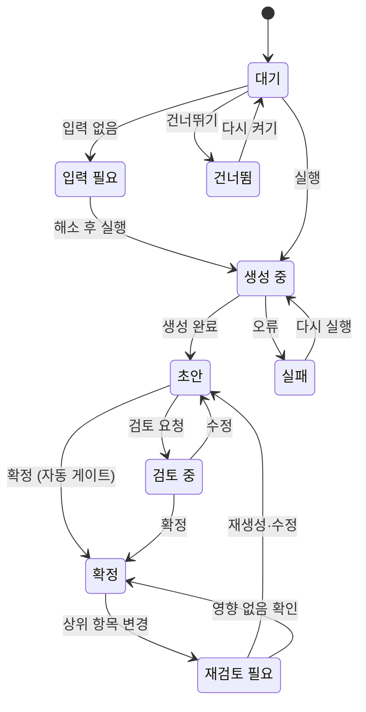
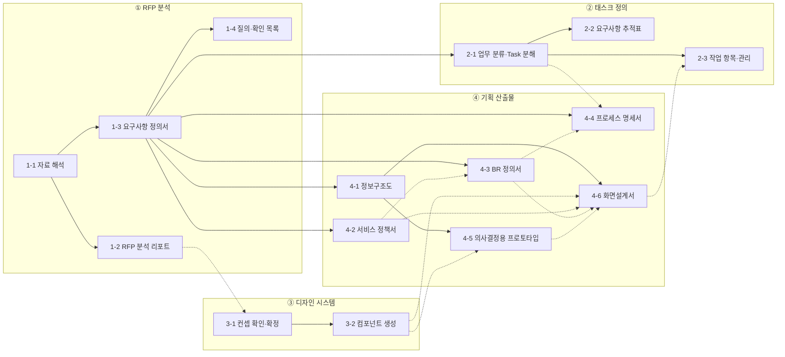
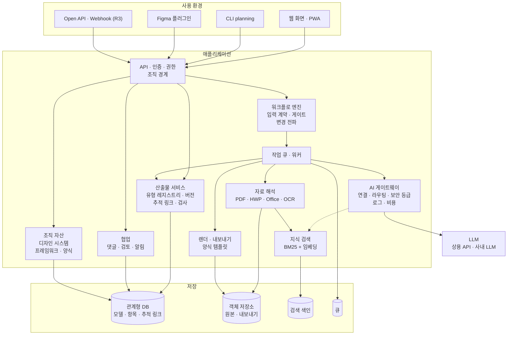
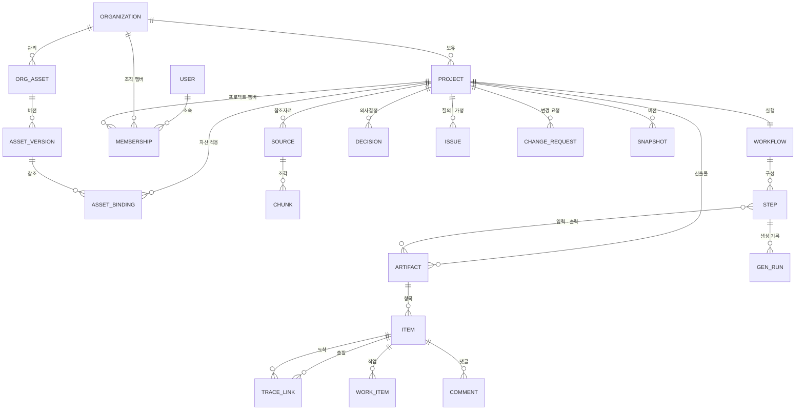

# PRD — Planning Studio (가칭): 기획 산출물 자동화 플랫폼

| 항목 | 내용 |
|---|---|
| 문서 버전 | v1.0 (초안) |
| 작성일 | 2026-10-11 |
| 상태 | Draft — 검토 요청 |
| 이전 판 | [PRD v0.7](./PRD-v0.7.md) — 현행 도구의 상세 기능 명세. 이 문서에서 `v0.7 F-XXX-nn`으로 참조한다 |
| 관련 문서 | [작업 계획서](./WORK_PLAN.md) · [ADR-001](./decisions/ADR-001-p0-foundation.md) · [ADR-002](./decisions/ADR-002-knowledge-design-viewer.md) · [ADR-003](./decisions/ADR-003-web-service.md) |

**개정 이력**
| 버전 | 일자 | 내용 |
|---|---|---|
| v1.0 | 2026-10-11 | 제품 범위 재정의. ① RFP 분석 → ② 태스크 정의 → ③ 디자인 시스템 → ④ 기획 산출물의 4단계 워크플로, 워크플로 구성(템플릿·목표로 만들기·직접 고치기)과 앞 단계 생략, 프로젝트 유형 프로파일(공공 SI·국가 R&D·민간·사내), 조직·공통 자산(선택 적용), 확장 아키텍처(산출물 유형 레지스트리), 현행 구현 대비 차이와 릴리스 계획. 새 산출물: 요구사항 정의서, RFP 분석 리포트, 질의·가정 목록, 작업 항목(WBS), 서비스 정책서, BR 정의서, 프로세스 명세서, 의사결정용 프로토타입 |
| v0.1~v0.7 | 2026-09-25 | [이전 판](./PRD-v0.7.md) 참조 |

> **읽는 법** — 기능 표의 **현행** 칸은 2026-10-11 기준 저장소 구현 상태다: ● 구현 · ◐ 일부 · ○ 없음.
> **우선** 칸: **P0** R1(MVP) 필수 · **P1** R1 목표(늦어지면 R2) · **P2** R2 팀·조직 · **P3** R3 이후.

**목차**
0. 한눈에 보기
1. 배경과 문제
2. 비전·목표·성공 지표
3. 사용자
4. 제품 원칙
5. 핵심 개념
6. 워크플로
7. 기능 요구사항
8. AI 생성 설계
9. UX·UI
10. 아키텍처
11. 비기능 요구사항
12. 릴리스 계획
13. 리스크와 대응
14. 오픈 이슈
- 부록 A 산출물 표준 항목 · B 공공 요구사항 분류 매핑 · C v0.7 → v1.0 대응 · D 참고 기준

---

## 0. 한눈에 보기

**한 줄 정의** — RFP·요청 자료를 올리면 요구사항 정의서부터 화면설계서까지 **서로 연결된 기획 산출물 한 벌**을 만들고, 사람이 검토·확정하며, 무엇이 바뀌면 함께 고쳐 주는 기획 산출물 자동화 플랫폼.

**네 단계**
| 단계 | 하는 일 | 대표 산출물 |
|---|---|---|
| ① RFP 분석 | 자료를 올리면 기능·비기능 요구사항을 찾아 정의서로 만든다 | 요구사항 정의서, RFP 분석 리포트, 질의 목록 |
| ② 태스크 정의 | 요구사항을 업무·시스템별 Task로 나누고 추적표와 작업 목록을 만든다 | 요구사항 추적표(RTM), Task, 작업 항목(WBS) |
| ③ 디자인 시스템 | 컨셉을 확인·확정하고(1Step) 컴포넌트를 만든다(2Step) | 디자인 컨셉, 토큰, 컴포넌트 |
| ④ 기획 산출물 | 정보구조도·정책·BR·프로세스·프로토타입·화면설계서를 만든다 | 정보구조도, 서비스 정책서, BR 정의서, 프로세스 명세서, 의사결정용 프로토타입, 화면설계서 |

**무엇이 다른가**
1. **문서가 아니라 모델** — 모든 산출물은 하나의 기획 데이터 모델에서 나오고 서로 추적된다.
2. **어디서든 시작** — RFP가 없어도, 앞 단계를 건너뛰어도 된다. 빠진 입력은 가져오기·간이 입력·가정으로 채우고, 채운 방법을 표시한다.
3. **워크플로를 고른다** — 템플릿을 고르거나, 만들 산출물만 고르면 필요한 단계가 자동으로 구성된다.
4. **공공과 민간을 함께** — 프로젝트 유형 프로파일이 분류 체계·ID 규칙·양식·점검 항목을 바꾼다.
5. **조직 자산은 골라 쓴다** — 회사 공통 디자인 시스템·개발 프레임워크·양식을 프로젝트마다 그대로 쓸지, 고쳐 쓸지, 안 쓸지 고른다.

**지금 어디에 있나** — 현행 Planning Studio(v0.x)에는 요구사항·시스템별 Task·요구사항 추적표, 정보구조도, 프로세스 플로우, 디자인 시스템(컨셉 → 컴포넌트, Figma 양방향), 화면설계서(AI 생성·항목 단위 수정·PPTX/PDF/엑셀 양식), 통합 프로토타입, 테스트 케이스, 버전 비교, 계정·멤버·AI 연결·공유 링크가 동작한다. 가장 큰 빈칸은 다섯 가지다.
1. RFP 자동 분석과 요구사항 정의서
2. 워크플로 구성과 앞 단계 생략
3. 서비스 정책서·BR 정의서·프로세스 명세서·의사결정 기록
4. 조직(테넌트)과 공통 자산
5. 다중 사용자 규모의 저장소와 작업 큐

**MVP(R1)** — "RFP를 올리면 요구사항 정의서가 나오고, 원하는 산출물까지 이어지는 워크플로"를 완성한다. 범위와 일정은 §12.

---

## 1. 배경과 문제

### 1.1 배경
기획 업무는 대체로 다음 순서로 흐른다.
```
요청 접수(RFP·메일·회의) → 요구사항 분석 → 작업 분해·추적 → 디자인 방향 → 상세 기획 산출물 → 디자인·개발 인계 → 변경 대응
```
- **공공 SI·국가과제**는 요구사항이 수백 건이고, 정해진 분류(SFR·PER·SER 등)와 요구사항 추적표, 감리 대응, KRDS·KWCAG 2.2 준수, 기관 제출 양식이 붙는다.
- **민간 프로젝트**는 빠른 의사결정, 브랜드에 맞는 디자인, 잦은 변경이 특징이다.
- 어느 쪽이든 산출물끼리 내용이 겹치고 얽혀 있어서, 한 곳이 바뀌면 여러 문서를 함께 고쳐야 한다.

### 1.2 문제
| # | 문제 | 현장에서 보이는 모습 | 결과 |
|---|---|---|---|
| 1 | RFP 분석이 수작업 | 100쪽 넘는 HWP·PDF를 읽고 요구사항을 엑셀로 옮기는 데 며칠. 비기능 요구(성능·보안·접근성)는 본문 곳곳에 흩어져 있음 | 누락, 착수 지연 |
| 2 | 산출물 사이가 끊김 | 요구사항 ↔ 화면 ↔ 정책 ↔ 업무 규칙 연결이 사람 기억에 의존 | 요구사항 누락, 감리 지적, 문서 간 불일치 |
| 3 | 같은 내용을 여러 양식에 | 정의서·추적표(엑셀), 화면설계서(PPT), 정책서(워드)에 같은 내용을 반복 기재 | 공수 낭비, 표기 불일치 |
| 4 | 변경 반영 비용 | 요구 1건이 바뀌면 영향받는 문서를 사람이 찾아 고침 | 반영 누락, 변경 설명 자료를 따로 작성 |
| 5 | 디자인 방향 합의가 늦음 | 컨셉 합의 없이 화면설계를 시작 | 화면 재작업 |
| 6 | 문서로는 결정이 안 됨 | 쟁점을 말로만 논의, 프로토타입은 만들기 비쌈 | 결정 지연·번복 |
| 7 | 조직 표준이 프로젝트에 안 닿음 | 회사 양식·디자인 시스템·개발 프레임워크가 있어도 프로젝트마다 다시 만듦 | 품질 편차, 재사용 없음 |
| 8 | 범용 AI 대화 도구의 한계 | 초안은 빠르지만 구조·근거·추적·버전·양식이 없음 | 실무 산출물로 바로 못 씀, 검증 불가 |

### 1.3 해결 방향
구조화된 기획 모델 + 근거 있는 AI 생성 + 사람의 검토·확정 + 추적성 + 실무 양식 출력을 **하나의 워크플로**로 묶는다. 사용자는 문서를 "작성"하기보다 AI가 만든 초안을 **검토하고 결정**한다.

### 1.4 대안과 차별점
| 대안 | 잘하는 것 | 부족한 것 | 이 제품 |
|---|---|---|---|
| 범용 AI 대화 도구 | 빠른 초안, 자유로운 질의 | 결과가 글 덩어리, 근거·추적·버전·양식 없음 | 구조화 모델 + 근거 + 추적 + 양식 |
| 문서·협업 도구의 AI 기능 | 문서 단위 요약·작성 | 산출물 간 연결과 기획 전용 스키마 없음 | 산출물 유형별 스키마와 추적 링크 |
| 요구사항 관리 도구 | 추적성·변경 관리 | 무겁고 비쌈, AI 생성·화면 산출물 없음, 국내 공공 양식 미흡 | 가벼운 추적 + 생성 + 공공 양식 |
| UI 생성 도구 | 빠른 화면 시안 | 요구사항·정책·업무 규칙과 무관한 화면 | 요구사항·BR·정책을 근거로 한 화면설계서 |

---

## 2. 비전·목표·성공 지표

### 2.1 비전
> 자료를 올리면 기획 산출물 한 벌이 서로 연결된 채로 나오고, 무엇이 바뀌면 함께 바뀐다.

### 2.2 목표
| ID | 목표 | 설명 |
|---|---|---|
| G1 | 빠르게 | RFP에서 요구사항 정의서 초안까지 며칠 → 1시간 안(검토 포함 반나절) |
| G2 | 빠짐없이 | 요구사항 → 산출물 추적 100%, 근거 없는 산출물 0건 |
| G3 | 유연하게 | 어느 단계에서든 시작하고, 필요한 산출물만 만든다 |
| G4 | 어디서나 | 공공 SI·국가 R&D·민간·사내 프로젝트를 프로파일만 바꿔 쓴다 |
| G5 | 표준대로 | 조직 공통 자산(디자인 시스템·개발 프레임워크·양식)을 프로젝트에 골라 적용한다 |

### 2.3 성공 지표 (KPI)
| 지표 | 정의 | R1 목표 | 1년 목표 |
|---|---|---|---|
| 요구사항 초안 소요 시간 | RFP 100쪽 기준, 올리기 → 요구사항 정의서 초안 | 15분 이내 | 10분 이내 |
| 요구사항 추출 재현율 | 정답 세트 대비 찾아낸 요구사항 비율 | 90% | 95% |
| 요구사항 추출 정밀도 | 추출 결과 중 맞는 요구사항 비율 | 85% | 90% |
| 비기능 요구 재현율 | 본문에 흩어진 비기능 요구를 찾아낸 비율 | 85% | 90% |
| AI 초안 채택률 | 큰 수정 없이 확정된 항목 비율 | 60% | 75% |
| 근거 없는 생성 비율 | 근거(자료 위치·상위 항목)도 '가정' 표시도 없는 항목 | 3% 이하 | 1% 이하 |
| 추적 커버리지 | 확정 요구사항 중 하위 산출물에 연결된 비율 | 100% (확정 조건) | 100% |
| 작성 시간 단축 | 요구사항 정의서~화면설계서, 수작업 대비 | 50% | 70% |
| 변경 영향 식별률 | 변경 요청의 영향 산출물을 자동으로 찾은 비율 | 80% | 90% |
| 공공 양식 재편집 | 제출 전 사람이 다시 손본 페이지 비율 | 10% 이하 | 5% 이하 |
| 워크플로 완주율 | 시작한 워크플로 중 목표 산출물까지 확정한 비율 | 40% | 60% |
| 조직 자산 적용률 | 조직 자산을 쓰는 프로젝트 비율 (R2부터) | — | 60% |

측정: 평가셋(§8.5, 부록 D)의 정답 세트, 생성 기록(AI 로그), 파일럿 프로젝트 작업 시간 기록.

### 2.4 하지 않는 것 (지금은)
- 개발 설계 산출물(API 명세·DB 설계·시퀀스) 생성 — v0.7 원칙 유지. R4에서 산출물 유형으로 추가할지 검토한다.
- 실제 서비스 코드 생성·배포 — 디자인 토큰·컴포넌트 코드 내보내기만 R3 이후 검토.
- 고해상도 비주얼 시안 대체 — 디자인 시스템과 와이어프레임 수준까지.
- 범용 PM 도구 대체 — 작업 관리는 산출물과 연결된 범위만 하고, 나머지는 Jira 등과 연동한다.
- 제안서 작성 — R4 검토.
- 법률 판단 — 정책서의 법규 관련 항목은 '법률 검토 필요'로 표시만 한다.

---

## 3. 사용자

### 3.1 대상 세그먼트
| 세그먼트 | 주 입력 | 꼭 필요한 산출물 | 특수 요건 |
|---|---|---|---|
| 공공 SI (나라장터 발주 사업) | 제안요청서(HWP·PDF), 과업지시서, 질의 응답 | 요구사항 정의서(원본 ID), 요구사항 추적표, 화면설계서(제출형), 정책·업무 규칙 | 요구사항 11종 분류, 감리 대응, KRDS·KWCAG 2.2, 외부 AI 사용 제한 가능 |
| 국가 R&D 과제 | 과제 공고·RFP, 연구개발계획서 | 요구사항(성과지표 → 검증 기준), 서비스 구조, 프로토타입 | 정량 성과지표, 단계 평가, 결과물 시연 |
| 민간 구축 (에이전시·SI) | 고객 RFP, 요청 메일, 회의록 | 정보구조도, 정책서, 화면설계서, 의사결정 프로토타입 | 브랜드·디자인 품질, 빠른 결정, 잦은 변경 |
| 사내 서비스 (PO·PM) | 아이디어·브리프, 기존 서비스 | 요구사항(경량), 프로토타입, 화면설계서 | RFP 없음, 속도, 회사 공통 디자인 시스템 |

### 3.2 페르소나
| 페르소나 | 상황 | 바라는 것 | 주로 쓰는 단계 |
|---|---|---|---|
| P1 공공 SI PL·기획 리드 | 나라장터 RFP 120쪽, 요구사항 180건, 감리 예정 | 요구사항 누락 0건, 원본 ID를 유지한 추적표, 기관 제출 양식 | 전 단계 |
| P2 에이전시 서비스 기획자 | 고객 RFP는 짧고 회의마다 요구가 바뀜 | 정책·화면설계서 빠른 초안, 쟁점은 프로토타입으로 결정 | ①④ |
| P3 사내 PO·스타트업 PM | RFP 없음, 아이디어와 회의록뿐 | 대화로 요구사항 정리, 바로 프로토타입 | 브리프 → ④ |
| P4 디자이너 | 컨셉 합의와 컴포넌트가 필요 | 컨셉 비교·확정, Figma 연동 | ③④ |
| P5 조직 관리자 (기획·디자인 조직장) | 프로젝트마다 품질 편차 | 공통 양식·디자인 시스템 배포, 프로젝트 현황 (R2부터) | 조직 |
| P6 검토자 (발주처·고객사·감리) | 산출물 검토·승인 | 로그인 없이 보기, 바뀐 곳이 보이는 자료 | 공유 링크 |
| P7 개발자·QA | 인계받아 구현·시험 | 화면·BR·추적표, 테스트 케이스 | 읽기 |

### 3.3 대표 시나리오

**A. 공공 SI — RFP로 전 단계 (진입점 E1, 템플릿 T1)**
1. 프로젝트 만들기 → 유형 '공공 SI' → "제안요청서가 있어요" → 시스템 구분 프리셋 '공공 민원형'(대국민·민원포털·심사자) 확인
2. 제안요청서(HWP 120쪽)·과업지시서(PDF)를 올리면 자동으로 해석·분석이 시작되고, 약 10분 뒤 요구사항 정의서 초안(SFR 86, PER 9, SER 14 …)과 질의 15건이 나온다
3. 원문 대조 화면에서 요구사항을 수락·수정·분할하고 확정한다. 질의서를 내보내 발주처에 보낸다
4. 시스템별 Task와 요구사항 추적표가 자동으로 만들어지고, 작업 항목이 업무별로 나뉜다. 담당자를 지정한다
5. 대국민 포털은 KRDS 구성 원칙 컨셉을 고르고(1Step), 컴포넌트를 만든다(2Step)
6. 정보구조도 → 서비스 정책서 → BR 정의서 → 프로세스 명세서 → 화면설계서를 차례로 생성·검토한다. 쟁점 2건은 의사결정 프로토타입으로 발주처와 결정한다
7. 화면설계서(공공 제출형 PPTX)와 요구사항 추적표(감리 대응 XLSX)를 내보낸다

**B. 민간 — 아이디어로 빠른 결정 (E3, T4)**
1. "아이디어만 있어요" → 대화형 브리프(10문항 안팎)에 답하고 회의록을 올린다
2. 경량 요구사항 정의서 → 정보구조도 → 기본 컨셉으로 의사결정 프로토타입 2안 생성
3. 공유 링크로 고객 의견을 받아 안 B로 결정(DEC-001) → 고른 안으로 화면설계서 초안 시작

**C. 중간부터 — 기능 목록 엑셀만 있음 (E2, 목표로 만들기)**
1. 만들 산출물로 '화면설계서, BR 정의서'를 고르면 도구가 필요한 스텝을 거꾸로 구성한다: 요구사항(가져오기) → 정보구조도 → BR → 화면설계서. 컨셉은 기본 컨셉으로 대체
2. 엑셀 열 매핑(기능 ID·기능명·설명·우선순위)으로 요구사항을 만들고 바로 진행한다
3. 나중에 RFP를 올리면 기존 요구사항·화면과의 연결 후보를 제안받는다(사후 연결)

**D. 변경 — 발주처가 요구를 바꿈 (E6)**
1. 변경 요청 메일(EML)을 올리면 변경 항목으로 나뉘고 기존 요구사항과 비교된다(신규·변경·삭제·충돌)
2. 추적 링크를 따라 영향받는 Task·정책·BR·화면을 찾아 '재검토 필요'로 표시한다
3. 앞 단계부터 반영안을 만들고 단계마다 확인하면, 변경 설명서와 개정 이력이 자동으로 남는다

**E. 조직 — 회사 표준 적용 (R2~R3)**
1. 조직 관리자가 회사 디자인 시스템 v2, 개발 프레임워크 프로파일(예: 전자정부 표준프레임워크 + 사내 UI 라이브러리), 화면설계서 양식을 등록한다
2. 새 프로젝트에서 '회사 디자인 시스템 확장'을 고르고 기관 CI 색만 덮어쓴다
3. 화면설계서의 컴포넌트 이름과 작업 공수가 프레임워크 프로파일 기준으로 맞춰진다. 회사 디자인 시스템 v3이 나오면 영향 미리보기를 보고 올릴지 고른다

---

## 4. 제품 원칙
| # | 원칙 | 뜻 |
|---|---|---|
| 1 | 모델이 원본, 문서는 출력 | 산출물은 구조화 모델에 저장하고 PPTX·XLSX·DOCX·HTML은 렌더링 결과다 (v0.7 계승) |
| 2 | 근거 없는 생성 금지 | 모든 생성 항목은 근거(자료 위치·상위 항목)를 갖거나 '가정'으로 표시된다 |
| 3 | AI는 초안, 확정은 사람 | 생성 → 미세조정 → 적용 → 검토 → 확정. 확정은 사람만 한다 |
| 4 | 어디서든 시작 | 단계는 생략·대체할 수 있다. 생략은 허용하되 숨기지 않는다 |
| 5 | 추적성이 기본값 | 항목은 만들어질 때부터 상위 항목과 연결된다 |
| 6 | 확장은 등록으로 | 산출물 유형·양식·프로파일·생성기는 코어를 고치지 않고 등록해서 늘린다 |
| 7 | 조직 자산은 골라 쓴다 | 조직 표준은 기본값을 줄 뿐 강제하지 않는다 |
| 8 | 데이터 등급에 맞는 AI | 프로젝트마다 외부 API·사내 LLM을 고르고, 금지된 경로로는 자료를 보내지 않는다 |
| 9 | 실무 양식 그대로 | 결과는 기관 제출형·엑셀·편집 가능한 PPT로 바로 나간다 |

---

## 5. 핵심 개념

### 5.1 개념 구조
```
조직 Organization (R2)
 ├─ 멤버 · 역할
 ├─ 조직 자산: 디자인 시스템 · 개발 프레임워크 프로파일 · 산출물 양식 · 워크플로 템플릿
 │             · ID 규칙 · 정책 라이브러리 · 용어 사전 · 공수 기준표 · AI 정책
 └─ 프로젝트 Project
     ├─ 프로젝트 유형 프로파일 (공공 SI · 국가 R&D · 민간 · 사내)
     ├─ 자산 적용 (사용 안 함 / 그대로 / 확장)
     ├─ 시스템 구분 (대국민 · 민원포털 · 심사자·관리자 · 외부 연계 …)
     ├─ 참조자료 → 조각(위치 포함) → 지식 검색
     ├─ 워크플로 → 스텝(산출물 유형 1개) → 게이트
     ├─ 산출물(유형별 모델) → 항목(ID) ⇄ 추적 링크
     ├─ 작업 항목 · 의사결정 · 질의·가정 · 변경 요청
     └─ 버전(스냅샷) · 생성 기록 · 댓글
```

### 5.2 용어
| 용어 | 뜻 | 비고 |
|---|---|---|
| 산출물 유형 | 요구사항 정의서·정보구조도·BR 정의서처럼 만들 수 있는 산출물의 종류. 스키마·입력 계약·생성기·검사기·내보내기를 묶어 등록한다 | 신규 (§10.4) |
| 항목 | 산출물 안에서 ID를 가진 단위 (요구사항, Task, 화면, 정책, BR, 프로세스 단계 …) | |
| 추적 링크 | 항목 사이의 연결. 종류: 근거(derives) · 구현(realizes) · 참조(refers) · 검증(verifies) | 현행은 필드 참조(`taskIds` 등) |
| 요구사항 | 기능(기능 명세 포함)·비기능 요구. 프로파일 분류 코드(예: SFR·PER)를 함께 가진다 | 현행 + 분류 확장 |
| 업무 분류 | 요구사항을 업무(도메인) 대·중·소로 묶는 분류. 작업 분해와 산출물 묶음의 기준 | 신규 |
| Task | 요구사항을 **시스템·행위자** 단위로 나눈 처리 단위. 추적의 기본 단위 | 현행 (v0.7 §3.5) |
| 작업 항목 (Work Item) | Task·화면·산출물을 만들기 위한 **일**. 작업 유형(기획·디자인·퍼블리싱·개발·테스트), 담당자, 기한, 공수, 상태 | 신규 — Task와 구분한다 |
| 워크플로 · 스텝 · 게이트 | 워크플로는 스텝의 묶음, 스텝은 산출물 유형 하나를 만드는 단위, 게이트는 다음 스텝으로 넘어가는 조건(자동·검토·승인) | 신규 (현행 S0~S5 단계 상태를 대체) |
| 입력 계약 | 스텝이 필요로 하는 입력(필수·선택)과, 빠졌을 때 채우는 방법 | 신규 |
| 진입점 | 사용자가 가진 자료에 따라 워크플로를 시작하는 위치 (E1~E6) | 신규 |
| 가정(ASM) · 질의(QNA) | 정보가 없어 임시로 정한 값 · 발주처·고객에게 물어야 할 것 | v0.7 Assumption·OpenIssue 구체화 |
| 의사결정(DEC) | 쟁점·대안·결정·결정자·근거의 기록. 정책·BR·화면에 연결 | 신규 (현행 정보구조도 표 '의사결정' 칸) |
| 프로파일 | 프로젝트 유형별 기본 설정 묶음 (분류 체계·ID 규칙·양식·템플릿·점검 항목) | 신규 |
| 조직 자산 | 조직이 버전으로 관리하고 프로젝트가 골라 쓰는 공통 자산 | 신규 |

### 5.3 상태
스텝과 산출물(항목)은 같은 상태 언어를 쓴다. 현행의 단계 상태(`StageStatus`)와 산출물 작업 상태(미진행·진행중·완료·재검토 필요)를 하나로 합친다.



| 상태 | 뜻 | 현행 대응 |
|---|---|---|
| 대기 | 실행 전 | NOT_STARTED · 미진행 |
| 입력 필요 | 필수 입력이 없음. 입력 해소 방법(§6.3)을 고르면 실행된다 | COLLECTING |
| 생성 중 | AI 생성·일괄 실행 중 | — |
| 초안 | 생성·적용됨, 검토 전 | DRAFTED · 진행중 |
| 검토 중 | 검토 요청됨 | IN_REVIEW |
| 확정 | 사람이 확정. 뒤 스텝의 기본 입력이 된다 | CONFIRMED · 완료 |
| 재검토 필요 | 확정 뒤 상위 항목이 바뀜 | NEEDS_UPDATE · 재검토 필요 |
| 건너뜀 | 사용자가 끈 스텝. 레일에 점선으로 남는다 | SKIPPED |
| 실패 | 생성 오류. 실패한 항목만 다시 실행한다 | — |

### 5.4 ID 체계
| 대상 | 형식 | 예 | 현행 |
|---|---|---|---|
| 요구사항 | `REQ-001` 또는 RFP 원본 ID, 상세화는 `-01` | `SFR-001`, `SFR-001-01`, `PER-003` | ● (상세화 분할 ○) |
| Task | `{요구사항ID}-T{nn}` | `SFR-002-T03` | ● |
| 작업 항목 | `WI-{nnnn}` | `WI-0042` | 신규 |
| 화면 | `{시스템}_{d1}_{d2}_{순번}`, 팝업은 `_P{nn}` | `CVL_INF_REG_010` | ● |
| 프로세스 | `PF-{nn}`, 단계는 `PF-{nn}-{nn}` | `PF-03`, `PF-03-04` | ◐ (단계 ID 신규) |
| 공통 상태값 | `ST-{코드}` | `ST-INFO` | ● |
| 정책 | `POL-{영역}-{nn}` | `POL-MEM-03` | 신규 |
| BR | `BR-{nnn}`, 업무 코드를 쓰면 `BR-{업무}-{nnn}` | `BR-014`, `BR-INF-007` | 신규 |
| 의사결정 | `DEC-{nnn}` | `DEC-002` | 신규 |
| 질의 · 가정 | `QNA-{nnn}` · `ASM-{nnn}` | `QNA-015` | 신규 |
| 변경 요청 | `CR-{nnn}` | `CR-001` | ● (모델) |
| 참조자료 | `SRC-{nnn}` | `SRC-003` | ● |
| 컴포넌트 | 영문 소문자·하이픈 | `data-table` | ● |

- 확정된 ID는 바꾸지 않는다. 지운 ID는 폐기 목록에 남기고 다시 쓰지 않는다 (현행 `retiredIds`, 요구사항 `DELETED`).
- 형식은 프로젝트에서 바꿀 수 있고, R2부터 조직 ID 규칙을 기본값으로 상속한다.

### 5.5 프로젝트 유형 프로파일
프로파일은 **설정 묶음**이다. 고른 뒤에도 항목마다 바꿀 수 있고, 새 프로파일(예: 금융·의료)은 설정 파일을 등록해서 늘린다.

| 설정 | 공공 SI | 국가 R&D 과제 | 민간 구축 | 사내 서비스 |
|---|---|---|---|---|
| 요구사항 분류 | 공공 11종(부록 B) + 기능/비기능 | 기능/비기능 + 성과지표 | 기능/비기능 + 품질 특성(ISO/IEC 25010) | 기능/비기능(경량) |
| 요구사항 ID | RFP 원본 ID | 과제 항목 번호 또는 `REQ-` | `REQ-` | `REQ-` |
| 시스템 구분 프리셋 | 공공 민원형 | 일반 서비스형 | 일반 서비스형 | 일반 서비스형 |
| 기본 워크플로 | T1 공공 SI 풀 패키지 | T2 R&D 과제 기획 | T3 민간 구축 | T4 빠른 의사결정 |
| 제출 양식 | 공공 제출형(PPTX 장표·엑셀 양식) | 일반형 + 성과지표 대응표 | 일반형 | 일반형 |
| 디자인 출발점 | KRDS 구성 원칙 컨셉 | 일반 컨셉 | 브랜드 기반 컨셉 | 조직 디자인 시스템 |
| 점검 항목 | KWCAG 2.2, 개인정보, 보안(시큐어코딩), 감리 추적성 | 성과지표 검증 가능성 | 개인정보, 전자상거래(해당 시) | 사내 표준 |
| 용어 | 발주기관·수요기관·과업 | 주관기관·연구과제·성과지표 | 고객사·과업 | 서비스·이해관계자 |
| 분석 리포트 강조 | 평가 기준(배점)·요구 산출물·사업 범위 | 연구 목표·성과지표·단계 평가 | 범위·일정·예산 | 목표·지표 |

현행에는 제출 양식(일반·공공), 시스템 구분 프리셋(공공 민원형·일반 서비스형), 요구사항 ID 모드(생성·원본)가 따로 있다. v1.0은 이를 프로파일 하나로 묶는다.

---

## 6. 워크플로

### 6.1 전체 구조 — 4단계 15스텝

실선은 필수 입력, 점선은 있으면 품질이 오르는 선택 입력이다. **2-2 요구사항 추적표는 모든 산출물이 바뀔 때마다 자동으로 갱신**되고(그림에서 생략), 변경 요청·버전·내보내기는 모든 스텝에 걸쳐 동작한다.

| 스텝 | 산출물 | 핵심 내용 | 현행 |
|---|---|---|---|
| 1-1 자료 해석 | 참조자료·조각 | 파일 해석, 위치 정보, 지식 색인 | ◐ |
| 1-2 RFP 분석 리포트 | 분석 리포트 | 사업 개요·범위·요구 산출물·평가 기준·일정·리스크 | ○ |
| 1-3 요구사항 정의서 | 요구사항(기능·비기능), 기능 명세 | 추출·분류·상세화·품질 검사·원문 대조 | ◐ 수동 등록·기능 명세 |
| 1-4 질의·확인 목록 | 질의(QNA)·가정(ASM) | 모호·누락·상충 → 질의서 | ○ |
| 2-1 업무 분류·Task 분해 | 업무 분류, Task | 업무 대·중·소, 시스템·행위자별 Task | ◐ 규칙 기반 Task |
| 2-2 요구사항 추적표 | RTM | 요구사항 → Task → 산출물, 누락·과잉 | ● |
| 2-3 작업 항목·관리 | 작업 항목(WBS) | 작업 유형별 분해, 담당·기한·공수·상태 | ◐ 정보구조도 표 진행 칸 |
| 3-1 컨셉 확인·확정 | 디자인 컨셉 | 컨셉 3종 비교 → 톤앤매너·UI/UX 확정 | ● |
| 3-2 컴포넌트 생성 | 토큰·컴포넌트 | 필요 컴포넌트 도출·생성·편집·Figma | ● |
| 4-1 정보구조도 | IA·화면 목록 | 시스템별 메뉴·화면 ID·채널 | ● |
| 4-2 서비스 정책서 | 정책 | 영역별 정책, 공통 상태값, 결정 필요 항목 | ◐ 공통 상태값만 |
| 4-3 BR 정의서 | 업무 규칙 | 조건·규칙·예외·메시지·예시 | ○ |
| 4-4 프로세스 명세서 | 플로우 + 단계 명세 | 레인·분기·예외, 단계 표 | ◐ 플로우만 |
| 4-5 의사결정용 프로토타입 | 대안 프로토타입·의사결정 | 쟁점별 안 비교, 결정 기록 | ◐ 통합 프로토타입 런타임 |
| 4-6 화면설계서 | 화면설계서·통합 프로토타입 | 와이어프레임·설명·옵션·유효성, 제출 양식 | ● |

### 6.2 입력 계약
스텝마다 필요한 입력을 선언한다. 워크플로 엔진은 이 표만 보고 실행 순서·생략 가능 여부·입력 해소 방법을 계산한다.

| 스텝 | 필수 입력 | 선택 입력 (있으면 품질↑) | 빠졌을 때 채우는 방법 |
|---|---|---|---|
| 1-3 요구사항 정의서 | 참조자료 1건 이상 또는 브리프 | 회의록·질의 응답·기존 시스템 자료 | 기존 정의서 가져오기 · 대화형 브리프 |
| 1-4 질의 목록 | 요구사항(초안) | 분석 리포트 | — |
| 2-1 Task 분해 | 요구사항, 시스템 구분 | 업무 분류, 참조자료 | 시스템 구분은 프리셋 제안 · 기능 목록 가져오기 |
| 2-2 추적표 | 요구사항 | 모든 하위 산출물 | 자동 계산 (항상 켜짐) |
| 2-3 작업 항목 | Task 또는 화면 목록 | 공수 기준표, 인력 | 기본 공수 기준표 |
| 3-1 컨셉 | 시스템 구분, 시스템 성격·사용자 | 분석 리포트(서비스 컨셉), 비기능(접근성·채널), 참조 URL, CI, 조직 디자인 시스템 | 기본 컨셉 자동 선택 (현행) |
| 3-2 컴포넌트 | 확정 컨셉 | 정보구조도·화면설계서에서 쓰는 요소 | 조직 디자인 시스템 상속 · 기본 카탈로그 |
| 4-1 정보구조도 | 요구사항 또는 시스템 설명 | Task, 기존 IA | 기존 IA 가져오기 · 시스템 설명만으로 생성 (현행) |
| 4-2 정책서 | 요구사항 | 공통 상태값, 조직 정책 라이브러리, 질의 응답 | 프로파일 기본 정책 목차 + 가정 |
| 4-3 BR 정의서 | 요구사항 | 정책서, 기능 명세, 화면 유효성 | 가정 |
| 4-4 프로세스 명세서 | 요구사항 | Task(레인·순서), BR, 정책, 화면 | Task 없이 요구사항만으로 생성 (현행) |
| 4-5 의사결정 프로토타입 | 쟁점 1개 이상 + 대상 화면 범위 | 디자인 시스템, 프로세스 | 화면 범위 직접 입력 · 기본 컨셉 와이어 |
| 4-6 화면설계서 | 화면(정보구조도 노드) | Task·기능 명세·BR·정책·디자인 시스템·결정 결과 | 화면 이름·메뉴 위치만으로 생성 · 기본 컨셉 (현행) |

### 6.3 진입점과 생략
| 진입점 | 가진 것 | 시작 스텝 | 기본 템플릿 |
|---|---|---|---|
| E1 | RFP·제안요청서·과업지시서 | 1-1 | T1 · T2 · T3 |
| E2 | 요구사항 정의서·기능 목록(엑셀) | 1-3 (가져오기) | T5 · T6 |
| E3 | 아이디어·브리프·회의록 | 1-3 (대화형 브리프) | T4 |
| E4 | 특정 산출물만 필요 | 해당 스텝 | T6 · T7 |
| E5 | 운영 중인 서비스 개선 (기존 IA·화면 캡처·URL) | 기존 서비스 분석 → 4-1 | T8 (R4 전까지는 기존 IA 가져오기) |
| E6 | 추가·변경 요청 (메일·회의록) | 변경 요청 | — |

**빠진 입력을 채우는 네 가지 방법** — 스텝을 켰는데 필수 입력이 없으면 '입력 필요'가 되고, 다음 중 하나를 고른다.
| 방법 | 동작 | 산출물 표시 |
|---|---|---|
| ① 앞 스텝 실행 | 꺼져 있던 앞 스텝을 켜고 실행 | — |
| ② 가져오기 | 엑셀·문서를 올리고 열을 매핑해 모델로 변환 | 출처: 가져온 파일 |
| ③ 간이 입력 | 최소 항목만 폼으로 입력 (예: 시스템 이름·사용자) | 출처: 직접 입력 |
| ④ 가정으로 진행 | AI가 임시 값을 만들고 가정(ASM)으로 기록 | '가정 포함' 표시. 확정 전에 해소하거나 '가정 유지'를 승인해야 한다 |

- **생략은 숨기지 않는다** — 건너뛴 스텝은 레일에 점선으로, 가정이 들어간 산출물은 머리에 노란 표시로 남는다.
- **사후 연결** — 나중에 앞 스텝을 채우면(예: 화면설계서를 만든 뒤 RFP를 올림) 기존 항목과의 추적 링크 후보를 제안하고, 연결되지 않은 요구사항을 '누락'으로 보여 준다.
- **순서 바꾸기** — 필수 입력만 충족되면 스텝 순서는 자유다 (예: 디자인 시스템을 가장 먼저).

### 6.4 워크플로 만들기
| 방법 | 설명 | 우선 |
|---|---|---|
| 템플릿 고르기 | 프로파일이 추천한 템플릿에서 시작 | P0 |
| 목표로 만들기 | 만들 산출물을 고르면 입력 계약을 거슬러 필요한 스텝을 자동 구성. 가진 자료를 표시하면 그 스텝은 가져오기로 바뀐다 | P0 |
| 직접 고치기 | 스텝 켜기·끄기, 순서, 게이트, 자동 실행 여부 | P0 |
| 말로 만들기 | "RFP는 없고 기능 목록 엑셀이 있어. 정책서랑 화면설계서만" → AI가 워크플로를 제안하고 사용자가 확인 | P1 |
| 템플릿으로 저장 | 프로젝트 워크플로를 내 템플릿으로, R2부터 조직 템플릿으로 | P1 · P2 |

목표로 만들기 예시 — 목표: BR 정의서 + 화면설계서, 가진 것: `기능 목록.xlsx`
```
1-3 요구사항 정의서   [가져오기: 기능 목록.xlsx]
4-1 정보구조도        [AI 생성]            ← 화면설계서의 필수 입력(화면)
3-1 컨셉             [기본 컨셉으로 대체]   ← 선택 입력, 나중에 켤 수 있음
4-3 BR 정의서         [AI 생성]
4-6 화면설계서         [AI 생성]            ← BR을 참조
2-2 요구사항 추적표    [항상 켜짐]
건너뜀: 1-1 · 1-2 · 1-4 · 2-1 · 2-3 · 3-2 · 4-2 · 4-4 · 4-5
```

### 6.5 기본 템플릿
| ID | 이름 | 스텝 | 대상 |
|---|---|---|---|
| T1 | 공공 SI 풀 패키지 | 1-1 → 1-2 → 1-3 → 1-4 → 2-1 → 2-2 → 2-3 → 3-1 → 3-2 → 4-1 → 4-2 → 4-3 → 4-4 → (4-5) → 4-6 | 공공 SI |
| T2 | 국가 R&D 과제 기획 | 1-1 → 1-2(성과지표) → 1-3 → 2-1 → 2-2 → 4-1 → 4-4 → 4-5 → (3-1 → 4-6) | 국가 R&D |
| T3 | 민간 구축 | 1-1 → 1-3 → 1-4 → 2-1 → 2-2 → 3-1 → 3-2 → 4-1 → 4-2 → 4-3 → 4-4 → 4-5 → 4-6 | 민간 |
| T4 | 빠른 의사결정 | 1-3(브리프·경량) → 4-1 → 3-1(기본 컨셉) → 4-5 | 사내·민간 초기 |
| T5 | 요구사항 관리 | 1-3(가져오기) → 1-4 → 2-1 → 2-2 → 2-3 | PM·PL |
| T6 | 화면설계서 단독 | 4-1(가져오기 가능) → 3-1(기본 컨셉) → 4-6 | 기획자 |
| T7 | 디자인 시스템 단독 | 3-1 → 3-2 | 디자이너 |
| T8 | 기존 서비스 개선 | 기존 서비스 분석(R4) 또는 기존 IA 가져오기 → 1-3 → 4-1(변경 표시) → 4-6 | 운영 서비스 |

괄호는 기본으로 꺼진 선택 스텝이다. 2-2 추적표는 모든 템플릿에서 항상 켜진다.

### 6.6 실행·게이트·변경 전파
- **실행 방식** — 자동(다음 검토 게이트까지 이어서) · 한 스텝씩 · 항목 하나만(화면 1개, 요구사항 1건).
- **트리거** — 자료를 올리면 1-1~1-3 자동 시작(끌 수 있음). 상위 스텝을 확정하면 다음 스텝 자동 생성(선택).
- **게이트** — 자동 통과 / 검토 후 진행(기본) / 승인 필요(R2, 승인자 역할).
- **초안으로 먼저 가기** — 기본은 확정본만 다음 스텝 입력으로 쓴다. 설정하면 초안으로 미리 만들고, 상위가 확정·변경되면 '재검토 필요'가 된다.
- **변경 전파** — 확정 항목이 바뀌면 추적 링크를 따라 하위 항목을 '재검토 필요'로 바꾸고 영향 목록을 보여 준다 → 부분 재생성 / 직접 수정 / 영향 없음(사유) 중 고른다. 현행은 요구사항·기능 명세·디자인 개정이 바뀌면 화면설계서·플로우가 자동으로 재검토 필요가 된다.
- **일괄 실행** — 화면 120개처럼 항목이 많으면 작업 큐로 나눠 실행하고 진행률·남은 시간·실패 항목만 다시 실행을 제공한다.

---

## 7. 기능 요구사항

### 7.0 워크플로·프로젝트 공통 (F0)
| ID | 기능 | 설명 | 우선 | 현행 |
|---|---|---|---|---|
| F0-01 | 프로젝트 만들기 마법사 | 이름·코드 → 프로젝트 유형 프로파일 → 진입점("무엇을 가지고 있나요?") → 만들 산출물 → 시스템 구분 프리셋 → 워크플로 미리 보기 → 자료 올리기 | P0 | ◐ 이름·유형·시스템 구분·제출 양식 |
| F0-02 | 워크플로 레일 | 프로젝트 상단에 4단계·스텝 상태. 건너뜀(점선)·가정 포함(노랑)·재검토 필요(빨강) 표시, 누르면 해당 스텝으로 | P0 | ◐ 대시보드 진행 순서 |
| F0-03 | 지금 할 일 | 스텝별 다음 행동(검토할 초안, 답 없는 질의, 재검토 필요, 미해소 가정)과 바로 가기 | P0 | ◐ 시스템별 지금 할 일 |
| F0-04 | 템플릿 | 기본 템플릿 T1~T8, 프로파일별 추천 | P0 | ○ |
| F0-05 | 목표로 만들기 | 목표 산출물 → 입력 계약 역추적 → 스텝 자동 구성. 가진 자료를 표시하면 가져오기로 전환 | P0 | ○ |
| F0-06 | 스텝 켜기·끄기 | 스텝 생략·다시 켜기, 생략 사유(선택), 순서 변경(필수 입력 충족 시) | P0 | ◐ IA 단계 패스·Task 없이 만들기 |
| F0-07 | 입력 해소 | '입력 필요' 스텝에서 네 가지 방법(앞 스텝·가져오기·간이 입력·가정) 제시 | P0 | ○ |
| F0-08 | 실행·트리거 | 자동·한 스텝·항목 단위 실행. 자료 올리기 → 자동 분석, 상위 확정 → 다음 자동 생성(선택) | P0 | ○ |
| F0-09 | 작업 큐·진행 | 긴 작업은 백그라운드에서 실행. 진행률·취소·실패 항목 재실행·완료 알림, 화면을 닫아도 계속 | P0 | ○ (Vercel 배포 시 생성 1회 최대 300초) |
| F0-10 | 변경 전파 | 상위 확정 항목 변경 → 하위 재검토 필요 + 영향 목록 → 부분 재생성·직접 수정·영향 없음 | P0 | ◐ 화면설계서·플로우·디자인 |
| F0-11 | 가정·질의 관리 | ASM·QNA 목록, 담당·기한·상태, 해소되면 관련 항목 갱신. 가정이 남은 산출물은 확정 시 경고 | P0 | ○ |
| F0-12 | 의사결정 기록 | DEC 목록(쟁점·대안·결정·결정자·일시·근거), 정책·BR·화면 연결 | P0 | ◐ 정보구조도 표 '의사결정' 칸 |
| F0-13 | 프로파일 | 프로젝트 유형 프로파일 적용·변경, 항목별 덮어쓰기, 새 프로파일 등록(설정 파일) | P0 | ◐ 흩어진 설정 |
| F0-14 | 게이트 설정 | 스텝별 자동·검토·승인(R2), 확정 조건 표시(예: 추적 누락 0건) | P1 | ○ |
| F0-15 | 사후 연결 | 앞 스텝을 나중에 채우면 기존 항목과의 추적 링크 후보 제안 | P1 | ○ |
| F0-16 | 말로 만들기 | 자연어로 워크플로 구성 제안 | P1 | ○ |
| F0-17 | 템플릿 저장·공유 | 내 템플릿(P1), 조직 템플릿(P2) | P1 | ○ |

**완료 기준 (P0)**
- 진입점 E1~E4에서 각각 프로젝트를 만들 수 있고, 마법사 마지막 화면에 구성된 워크플로가 보인다.
- '목표로 만들기'에서 목표 산출물만 고르면 필요한 스텝이 빠짐없이 켜지고, 꺼진 스텝은 레일에 점선으로 남는다.
- 필수 입력이 없는 스텝은 실행되지 않고 '입력 필요'와 네 가지 해소 방법을 보여 준다.
- 요구사항 1건을 바꾸면 연결된 하위 항목이 모두 '재검토 필요'가 되고 영향 목록에 나온다.

### 7.1 ① RFP 분석 — 요구사항 정의서 (F1)
| ID | 기능 | 설명 | 우선 | 현행 |
|---|---|---|---|---|
| F1-01 | 올리면 자동 시작 | 파일을 올리면 해석 → 요구사항 추출 → 정의서 초안까지 자동 실행. 단계별 진행 표시·완료 알림, 끌 수 있음 | P0 | ○ (올리기·색인만) |
| F1-02 | 문서 해석 | PDF·DOCX·TXT·MD·HTML·EML·CSV(현행) + **HWP·HWPX·XLSX·PPTX**(P0) + 스캔 PDF·이미지 OCR(P1). 쪽·절·표 칸 위치 보존, 요구사항 총괄표·상세표 같은 표 구조 인식 | P0 | ◐ |
| F1-03 | 여러 자료 함께 | 제안요청서 + 과업지시서 + 질의 응답 + 회의록을 한 번에. 자료 종류 자동 판별, 같은 요구가 여러 자료에 있으면 하나로 합치고 출처를 모두 남김 | P0 | ○ |
| F1-04 | 요구사항 추출 | 요구 문장·항목 → 요구사항. 원본 ID(SFR-001) 보존, 출처 위치 연결, 원문 인용 | P0 | ○ (수동 등록 ●) |
| F1-05 | 분류 | 기능/비기능 + 프로파일 분류 코드(공공 11종·품질 특성) + 업무 분류 제안 + 우선순위(필수·권장·선택) | P0 | ◐ 유형 5종·우선순위 3단계 |
| F1-06 | 비기능 식별 | 성능·보안·접근성·호환성·데이터·인터페이스·운영 요구를 문서 전체에서 모아, 측정 가능한 기준(수치·검증 방법)으로 다시 씀. 기준이 없으면 질의 생성 | P0 | ○ |
| F1-07 | 기능 정의 | 기능 요구사항마다 기능 명세(입력·처리·출력·예외 초안). 뒤 스텝 생성 프롬프트에 함께 실림 | P0 | ◐ 기능 명세 편집·참조자료 초안 |
| F1-08 | 품질 검사 | 모호어('등'·'적절히'·'신속히'), 검증 불가, 한 문장 여러 요구, 상충, 짝 누락(등록은 있는데 수정·삭제 없음, 권한·예외 없음) 경고 | P0 | ◐ 모호 표시 필드 |
| F1-09 | 원문 대조 검토 | 왼쪽 원문(근거 위치 강조) ↔ 오른쪽 요구사항 표. 수락·수정·거절·병합·분할, 여러 건 한꺼번에, 신뢰도 낮은 것 먼저 보기 | P0 | ○ |
| F1-10 | 정의서 내보내기 | XLSX(공공 표준 열 / 조직 양식 열 매핑), DOCX, PDF. 개정 이력 포함 | P0 | ○ |
| F1-11 | 가져오기 | 기존 요구사항 정의서·기능 목록·추적표 XLSX/CSV. 열 매핑 화면, 매핑 저장 | P0 | ○ |
| F1-12 | 상세화 | 상위 요구사항을 상세 요구사항(SFR-001-01)으로 분할, 중복 병합, 원문 대비 변경 표시 | P1 | ○ |
| F1-13 | 질의·확인 목록 | 모호·누락·상충·기준 없음 → 질의(번호·질의·근거·제안 답). 질의서 내보내기, 답변 기록 → 요구사항 반영 | P1 | ○ |
| F1-14 | RFP 분석 리포트 | 사업 개요(사업명·발주기관·기간·예산·범위), 요구 산출물 목록, 평가 기준·배점, 일정, 핵심 이슈·리스크, 숨은 요구. 서비스 컨셉 요약은 3-1 입력이 된다 | P1 | ○ |
| F1-15 | 대화형 브리프 | RFP가 없을 때 질문 세트(v0.7 부록 A 재사용)로 아직 답이 없는 것만 묻고 요구사항 초안 생성 | P1 | ○ |
| F1-16 | 성과지표 변환 (R&D) | 정량 성과지표 → 비기능·품질 요구 + 검증 방법(시험 조건·측정 방법) | P1 | ○ |

**완료 기준 (P0)**
- 샘플 RFP 3건(공공 HWP 100쪽 안팎, 공공 PDF, 민간 DOCX)을 올리면 15분 안에 요구사항 정의서 초안이 나온다.
- 원본 ID가 있는 RFP에서 원본 요구사항 누락 0건. 정답 세트 대비 재현율 90%, 정밀도 85% 이상.
- 모든 요구사항에 출처 위치가 있고, 출처가 없으면 '가정'으로 표시된다.
- 요구사항 300건을 원문 대조 화면에서 끊김 없이 검토·일괄 처리할 수 있다.
- 요구사항 정의서 XLSX가 부록 A-1의 열 구성으로 나온다.

### 7.2 ② 태스크 정의 — 추적표·작업 관리 (F2)
| ID | 기능 | 설명 | 우선 | 현행 |
|---|---|---|---|---|
| F2-01 | 업무 분류 | 요구사항을 업무 대·중·소로 묶는 분류 제안·편집. 업무 코드는 정책·BR·화면 ID에 쓸 수 있다 | P0 | ○ |
| F2-02 | Task 분해 (AI) | 요구사항 → 시스템·행위자별 Task를 AI가 근거와 함께 제안. 규칙 기반은 누락 점검용으로 유지 | P0 | ◐ 규칙 기반 ● |
| F2-03 | Task 편집 | 추가·삭제·병합, 시스템 변경, 순서·선행, 자료 상태 전이, 화면 없는 사유 | P0 | ● |
| F2-04 | 누락 시스템 점검 | 흐름상 필요한 Task 누락 경고(승인 후 공개처 없음, 반려 후 재신청 없음 등) | P0 | ◐ |
| F2-05 | 요구사항 추적표 | 보기 3종(요구사항별·요구사항×시스템·산출물 역추적), 누락·과잉, 충족 상태 자동 계산 (v0.7 F-RTM-01~06) | P0 | ● |
| F2-06 | 추적표 확장 열 | 정책·BR·프로세스 단계·의사결정·테스트 케이스·작업 항목 열 추가, 보일 열 고르기 | P0 | ○ |
| F2-07 | 추적표 내보내기 | XLSX(감리 대응·조직 양식 열 매핑, 시스템별 시트), PDF | P0 | ◐ XLSX(요구사항별·매트릭스) |
| F2-08 | Task 상세 보기 | Task 하나에 연결된 프로세스 플로우·화면설계서·프로토타입을 모아 보고, 완료되면 통합 산출물에 반영 (v0.7 F-TSK) | P0 | ● |
| F2-09 | 작업 항목 분해 | Task·화면·산출물 → 작업 유형(기획·디자인·퍼블리싱·개발·테스트)별 작업 항목, 선행 관계, 공수 추정(기준표 + AI 보정) | P1 | ◐ 정보구조도 표 디자인·퍼블·개발 진행 칸 |
| F2-10 | 작업 관리 보기 | 표·보드(칸반). 담당자·기한·상태·업무·시스템 필터, 내 작업. 일정(간트)은 P2 | P1 | ○ |
| F2-11 | 산출물 상태 연동 | 기획 작업 항목은 연결된 산출물 상태로 자동 진행(초안 → 진행 중, 확정 → 완료) | P1 | ◐ 산출물 작업 상태 ● |
| F2-12 | 공수 기준표 | 화면 유형·작업 유형별 기준 공수(프로젝트 → 조직 상속) | P1 | ○ |
| F2-13 | WBS 내보내기·연동 | XLSX(P1), Jira·Redmine 등 내보내기·상태 동기화(P2) | P1 | ○ |
| F2-14 | 커버리지 현황 | 업무·시스템·산출물 유형별 추적 커버리지와 진척 | P1 | ◐ |

**완료 기준 (P0)**
- 샘플 요구사항(정보공개)이 민원포털·심사자·대국민 Task로 나뉘고, 반려 시 재신청 Task가 빠지면 경고가 뜬다 (v0.7 부록 C 사례).
- 추적표에 정책·BR·프로세스 단계 열이 붙고, 연결이 없는 요구사항은 '누락'으로 나온다.

### 7.3 ③ 디자인 시스템 (F3)
**1Step — 컨셉 확인·확정**
| ID | 기능 | 설명 | 우선 | 현행 |
|---|---|---|---|---|
| F3-01 | 컨셉 입력 정리 | 시스템 성격(대국민·신청 서비스·업무 관리)·사용자, 분석 리포트의 서비스 컨셉, 비기능(접근성·채널), 참조 URL, 기관 CI·브랜드 색·로고, 조직 디자인 시스템을 한 화면에 모아 확인 | P0 | ◐ |
| F3-02 | 컨셉 3종 제안 | 방향이 다른 컨셉 3종(규칙 + AI). 색·글꼴·모서리·밀도 토큰과 레이아웃 규칙 | P0 | ● |
| F3-03 | 화면 유형 미리보기 | 로그인·대시보드·메인·목록·상세·등록·확인 창·알림 창·토스트·모달을 같은 내용으로 나란히, 1920×1080 실제 규격 | P0 | ● |
| F3-04 | 단계별 컨셉·섞기 | 톤앤매너·CSS와 UI·UX 규칙을 따로 정하고, 다른 컨셉의 톤이나 구성만 가져와 섞기 | P0 | ● |
| F3-05 | 확정과 변경 | 컨셉 확정(잠금). 확정 뒤 바꾸면 영향 화면 목록과 재검토 필요 표시 | P0 | ◐ 재검토 필요 ● |
| F3-06 | 접근성 점검 | 글자·배경 대비 4.5:1, 포커스 표시, 최소 글자 크기, 터치 영역 점검과 자동 보정 제안 | P0 | ◐ 대비 자동 보정 |
| F3-07 | 출발점 고르기 | 공공: KRDS 구성 원칙 컨셉 / 조직 디자인 시스템 / 빈 컨셉 | P1 | ◐ KRDS 구성 원칙 |

**2Step — 컴포넌트 생성**
| ID | 기능 | 설명 | 우선 | 현행 |
|---|---|---|---|---|
| F3-08 | 필요 컴포넌트 도출 | 정보구조도·화면설계서·화면 유형에서 쓰는 요소를 모아 만들 목록 제안 | P0 | ● 초안 생성기 |
| F3-09 | 컴포넌트 생성 | '지금 모양으로' / 'AI 초안'으로 한꺼번에 생성. 변형(기본·비활성·오류)·상태, 프레임 편집기(오토 레이아웃·토큰 연결) | P0 | ● |
| F3-10 | 조정 | 섹션별 프롬프트, 이미지 핀·번호 라벨 댓글, 전역 프롬프트, 직접 편집, 개정 번호·되돌리기 (v0.7 F-DSR) | P0 | ● |
| F3-11 | 일괄 반영 | 디자인 시스템이 바뀌면 그 컴포넌트를 쓰는 모든 화면을 다시 그리고 재검토 필요 표시 | P0 | ● |
| F3-12 | 내보내기 | Figma 변수·컴포넌트(양방향), 토큰 JSON(DTCG), CSS 변수 | P0 | ● (CSS 변수 파일 ◐) |
| F3-13 | 문서화 | 컴포넌트 사용 가이드(용도·변형·쓰지 말 것·접근성) 자동 작성, 디자인 시스템 가이드 내보내기 | P1 | ○ |
| F3-14 | 조직 디자인 시스템 적용 | 조직 디자인 시스템을 그대로 / 확장(브랜드 토큰·일부 컴포넌트 덮어쓰기) / 사용 안 함. 버전 고정, 새 버전 알림·영향 미리보기 | P2 | ○ |
| F3-15 | 개발 프레임워크 매핑 | 컴포넌트 ↔ 프레임워크 UI 라이브러리의 컴포넌트 이름·지원 속성·제약 (예: 그리드 제품의 정렬·엑셀 내려받기 지원 여부) | P3 | ○ |
| F3-16 | 코드 내보내기 | 토큰 → CSS·Tailwind 설정, 컴포넌트 → 코드 골격 | P3 | ○ |

### 7.4 ④ 기획 산출물 (F4)

#### 4-1 정보구조도 (F4-IA)
| ID | 기능 | 설명 | 우선 | 현행 |
|---|---|---|---|---|
| F4-IA-01 | 생성 | 시스템별 메뉴·화면 트리, 화면 ID 자동 부여·불변, 화면 유형, 로그인·권한, 채널 (v0.7 F-IA) | P0 | ● |
| F4-IA-02 | 편집 | 캔버스(사이트맵 가로·세로), 표(엑셀) 보기, 화면 ↔ Task 연결 | P0 | ● |
| F4-IA-03 | 화면 목록 | 화면 ID·이름·유형·채널·본수·진행을 화면 목록으로 내보내기 | P0 | ● XLSX |
| F4-IA-04 | 내보내기 | XLSX·PDF·PNG·SVG(현행), PPTX 사이트맵·FigJam(P1) | P0 | ◐ |
| F4-IA-05 | 권한 매트릭스 | 사용자 유형 × 메뉴 접근 권한 표 | P1 | ○ |
| F4-IA-06 | 변경 표시 | 신규·변경·삭제·유지와 사유 (기존 서비스 개선) | P1 | ◐ 모델 필드 |

#### 4-2 서비스 정책서 (F4-PO) — 신규
| ID | 기능 | 설명 | 우선 | 현행 |
|---|---|---|---|---|
| F4-PO-01 | 정책 영역 도출 | 요구사항에서 필요한 영역을 찾아 목차 구성: 회원·인증, 권한, 개인정보, 콘텐츠·게시, 신청·처리, 결제·환불(해당 시), 알림, 운영·CS, 데이터 보존, 접근성 등. 프로파일별 기본 목차 | P0 | ○ |
| F4-PO-02 | 정책 항목 | ID·영역·정책명·내용·적용 대상(시스템·사용자)·예외·근거(요구사항·법규·결정)·관련 BR·화면·상태 | P0 | ○ |
| F4-PO-03 | 공통 상태값 | 여러 시스템에 걸친 상태값 세트를 '상태 정책'으로 정의하고 모든 산출물이 참조 (v0.7 F-SYS-05) | P0 | ● |
| F4-PO-04 | 결정 필요 항목 | 정할 수 없는 정책은 선택지·권장안·근거와 함께 '결정 필요'로 두고 질의·의사결정·프로토타입으로 연결 | P0 | ○ |
| F4-PO-05 | 내보내기 | DOCX, XLSX, PDF | P0 | ○ |
| F4-PO-06 | 법규 표시 | 개인정보·전자상거래 등 법규 관련 항목에 '법률 검토 필요' 표시 (판단은 하지 않음) | P1 | ○ |
| F4-PO-07 | 상충 검사 | 정책끼리, 정책 ↔ 요구사항 상충 경고 | P1 | ○ |
| F4-PO-08 | 정책 라이브러리 | 조직 표준 정책(회원·개인정보·보안 등)을 불러와 프로젝트에 맞게 수정 | P2 | ○ |

#### 4-3 BR 정의서 (F4-BR) — 신규
| ID | 기능 | 설명 | 우선 | 현행 |
|---|---|---|---|---|
| F4-BR-01 | BR 추출 | 요구사항·기능 명세·정책·화면 유효성에서 업무 규칙 후보 추출 | P0 | ○ |
| F4-BR-02 | BR 항목 | ID·업무·규칙명·유형(검증·계산·상태 전이·권한·제약·시점·알림)·조건·규칙·예외·오류 메시지·예시(입력 → 기대 결과)·근거·적용 화면·적용 프로세스 단계 | P0 | ○ |
| F4-BR-03 | 화면 연동 | 화면설계서 항목의 유효성·노출 조건이 BR ID를 참조. BR이 바뀌면 그 화면이 재검토 필요 | P0 | ◐ 화면 항목별 유효성 직접 기재 |
| F4-BR-04 | 내보내기 | XLSX, DOCX | P0 | ○ |
| F4-BR-05 | 결정표 | 조건 조합이 많은 규칙은 결정표(조건 × 결과)로 보기·편집 | P1 | ○ |
| F4-BR-06 | 검사 | 중복·상충·모호 표현·예시 없음(시험 불가) 경고 | P1 | ○ |
| F4-BR-07 | 테스트 연계 | BR 예시 → 테스트 케이스 초안 | P1 | ◐ 화면 기준 테스트 케이스 ● |

#### 4-4 프로세스 명세서 (F4-PS)
| ID | 기능 | 설명 | 우선 | 현행 |
|---|---|---|---|---|
| F4-PS-01 | 프로세스 플로우 | 요구사항 단위 생성, 시스템·주체 레인, Task·화면 연결, 반려·보완 루프, 표준 도형 (v0.7 F-DGM) | P0 | ● |
| F4-PS-02 | 캔버스 편집 | 도형 7종·레인·연결, 자동 정렬, AI로 그리기·고치기 | P0 | ● |
| F4-PS-03 | 단계 명세 표 | 플로우 노드와 1:1 — 단계 ID·주체·활동·입력·출력·관련 화면·BR·정책·분기 조건·예외 | P0 | ○ |
| F4-PS-04 | 프로세스 개요 | 목적·트리거·선행·후행 조건·관련 요구사항·참여 시스템 | P0 | ○ |
| F4-PS-05 | 내보내기 | PPTX(편집 가능)·PDF·PNG·SVG(현행), 명세서 DOCX(P0), BPMN(P3) | P0 | ◐ |
| F4-PS-06 | 사용자 플로우 | 사용자 유형별 화면 이동 흐름 (진입 → 화면 → 분기 → 목표) | P1 | ◐ 모델만 |
| F4-PS-07 | 통합·시스템별 보기 | 업무 전체 통합 플로우, 시스템 레인만 남긴 보기 | P1 | ◐ |
| F4-PS-08 | 검사 | 판단 분기 누락, 끝나지 않는 경로, 주체 없음, 화면 없는 사용자 단계 | P1 | ○ |
| F4-PS-09 | As-Is / To-Be | 나란히 보기와 변경 설명표 (v0.7 F-DGM-04) | P2 | ○ |

#### 4-5 의사결정용 프로토타입 (F4-DP)
화면설계서를 확정하기 **전에** 쟁점을 화면으로 보고 결정하기 위한 가벼운 프로토타입이다. 화면설계서 **뒤에** 만드는 통합 프로토타입(시연·검수용, F4-SB-10)과 구분한다.

| ID | 기능 | 설명 | 우선 | 현행 |
|---|---|---|---|---|
| F4-DP-01 | 쟁점 정리 | 질의·결정 필요 정책·모호 요구사항에서 화면으로 보면 좋을 쟁점 후보 제안 (예: "가입: 간편인증 먼저 vs 아이디 먼저") | P0 | ○ |
| F4-DP-02 | 대안 생성 | 쟁점마다 같은 화면 범위로 안 2~3개 생성. 디자인 시스템이 있으면 적용, 없으면 기본 컨셉 와이어 | P0 | ○ |
| F4-DP-03 | 클릭형 HTML | 화면 이동·탭·확인 창·오류 문구 동작, 단일 HTML 내보내기 | P0 | ● 통합 프로토타입 런타임 |
| F4-DP-04 | 비교 보기 | 안 A·B 나란히 보기·전환, 화면별 차이 강조 | P0 | ○ |
| F4-DP-05 | 결정 기록 | 결정 → DEC 기록(쟁점·안·결정·결정자·일시·근거) → 정책·BR·화면설계서에 연결 | P0 | ○ |
| F4-DP-06 | 화면설계서로 넘기기 | 고른 안의 화면으로 화면설계서 초안 시작 | P1 | ○ |
| F4-DP-07 | 의견·투표 | 공유 링크로 안별 의견·선호 표시 | P2 | ◐ 읽기 전용 공유 링크 ● |

#### 4-6 화면설계서 (F4-SB)
현행에서 가장 많이 구현된 산출물이다. 상세는 v0.7 F-SB·F-GEN·F-AI를 따른다.

| ID | 기능 | 설명 | 우선 | 현행 |
|---|---|---|---|---|
| F4-SB-01 | 생성·미세조정 | 화면 단위 AI 생성, 버전별 미세조정, 고칠 항목만 수정(나머지 잠금), 처음부터 다시 | P0 | ● |
| F4-SB-02 | 와이어프레임 | 디자인 시스템 컴포넌트·props로 그림, 1920 실제 규격, 채널별(모바일 390·태블릿 1024) 다시 그리기 | P0 | ● |
| F4-SB-03 | 설명 | 번호 마커 + 기획자·고객 관점 설명, 옵션 값, 유효성(필수·형식·길이·시점·메시지), 이동 화면 | P0 | ● |
| F4-SB-04 | 캔버스 편집 | 항목 모양·내용·순서·복제·삭제, 새 항목 그리기, 번호 위치 | P0 | ● |
| F4-SB-05 | 기능 요구 충족 점검 | 기능 명세·Task 줄 → 반영 항목 매핑, 미반영 줄 보완 | P0 | ● |
| F4-SB-06 | BR·정책 참조 | 설명·유효성에 BR·정책 ID를 링크로 넣고 내용을 펼쳐 보기 | P0 | ○ |
| F4-SB-07 | 제출 양식 | PPTX(편집 가능한 표)·PDF·인쇄용 HTML·엑셀 양식(기관 제출용), 표지·목차, 자동 페이지 분할·계속 표기(v0.7 F-SB-09), 개정 이력 장표 | P0 | ◐ 개정 이력·분할 고도화 |
| F4-SB-08 | 버전 비교 | 스냅샷 ↔ 지금 나란히, 항목별 낱말 단위 차이 | P0 | ● |
| F4-SB-09 | 공통 정의 장표 | 공통 UI·공통 메시지·공통 유효성을 앞에서 한 번 정의하고 화면에서 참조 (v0.7 F-SB-10) | P1 | ○ |
| F4-SB-10 | 통합 프로토타입 | 시스템별 전체 화면을 메뉴 순서로 잇는 클릭형 프로토타입(현행), 시스템 간 시나리오 모드(P1) | P0 | ◐ 시나리오 모드 ○ |
| F4-SB-11 | 메시지 목록 | 확인·알림·토스트·오류 문구를 모아 메시지 정의서로 | P1 | ○ |
| F4-SB-12 | Figma | Figma로 그리기(현행: Figma MCP용 프롬프트), 프레임 직접 생성(P2) | P1 | ◐ |
| F4-SB-13 | 조직 양식 | 조직 PPTX 마스터를 올려 영역 매핑 | P2 | ○ |

### 7.5 공통 기능 (F5)
| ID | 기능 | 설명 | 우선 | 현행 |
|---|---|---|---|---|
| F5-01 | AI 생성 창 | 생성 → v1·v2… 미세조정 → 검사 → 적용·적용 해제. 연결된 API로 바로 생성하거나, 프롬프트 복사 → claude.ai 등 대화형 AI에서 생성 → 결과 붙여넣기 | P0 | ● |
| F5-02 | 근거 보기 | 항목마다 근거(자료 위치 인용·상위 항목)와 가정 표시, 근거 원문으로 이동 | P0 | ◐ 요구사항 출처·참조자료 근거 |
| F5-03 | 검사기 | 산출물별 형식·참조 무결성·누락·품질 검사. 오류는 적용·확정 불가, 경고는 표시 (§8.3) | P0 | ◐ |
| F5-04 | 버전 | 스냅샷·Diff·되돌리기·화면 버전 비교(현행), 베이스라인(확정 기준선) 지정(P1) | P0 | ● |
| F5-05 | 내보내기 센터 | 산출물·버전·형식 고르기, 패키지(zip) | P0 | ● |
| F5-06 | 공유 링크 | 읽기 전용 공유(현행). 만료·범위(산출물 선택)·댓글 허용은 P2 | P0 | ● |
| F5-07 | 변경 요청 센터 | 메일·파일·텍스트 입력 → 변경 항목 분해(신규·변경·삭제·중복·충돌) → 영향도 → 앞 단계부터 순차 반영 → 변경 설명서·개정 이력 (v0.7 F-CR) | P1 | ◐ 모델·추적표 이력 |
| F5-08 | 댓글·검토 | 항목·화면에 댓글·멘션, 검토 요청·검토 완료. 현행은 디자인 이미지 핀 댓글 | P1 | ◐ |
| F5-09 | 용어 사전 | 프로젝트 용어·금칙어·표기 규칙을 생성·검사에 적용, 조직 사전 상속(P2) | P1 | ○ |
| F5-10 | AI 도우미 | 지금 보는 산출물·선택 항목을 맥락으로 질문·명령 ("이 화면에 예외 처리 추가", "SFR-012 관련 BR 찾기"). 변경은 미리보기 후 적용 | P1 | ○ |
| F5-11 | 알림 | 생성 완료·검토 요청·멘션·재검토 필요, 새 버전 배포 알림(현행) | P1 | ◐ |
| F5-12 | 통합 검색 | 요구사항·화면·정책·BR·참조자료를 한 번에 검색, ID로 바로 가기 | P1 | ◐ 참조자료 검색 |
| F5-13 | 테스트 케이스 | 화면·BR 기준 테스트 케이스 초안·AI 작성, 채널별 결과 (현행 확장 산출물) | P1 | ● |
| F5-14 | 승인 | 게이트 승인자, 승인 기록, 외부 검토자 승인 | P2 | ○ |
| F5-15 | 기획 개요서 | 분석 리포트·요구사항·정책 요약을 묶은 문서형 산출물 (v0.7 기획안을 대체하는 선택 산출물) | P2 | ○ |

### 7.6 계정·조직·공통 자산 (F6)
| ID | 기능 | 설명 | 우선 | 현행 |
|---|---|---|---|---|
| F6-01 | 가입·로그인 | 이메일·비밀번호, 세션, 비밀번호 변경, 초대받은 이메일만 가입 설정 | P0 | ● |
| F6-02 | 프로젝트 멤버 | 운영자·작업자·열람자, 초대 링크(14일), 권한 변경, 마지막 운영자 보호 | P0 | ● |
| F6-03 | AI 연결 | 프로젝트·개인 연결 여러 개, 모델 불러오기, 키 암호화·비공개 (Anthropic API·OpenAI 호환·로컬 LLM·Gemini) | P0 | ● |
| F6-04 | 서비스 관리자 | 회원 목록·삭제, 상태 확인 | P0 | ● |
| F6-05 | 메일 발송 | 비밀번호 재설정, 초대 메일 | P1 | ○ |
| F6-06 | 소셜·기업 로그인 | Google·Microsoft 등 OIDC | P2 | ○ |
| F6-07 | 조직 | 조직(회사) 만들기, 멤버 초대, 회사 도메인 자동 가입, 여러 조직 소속·전환 | P2 | ○ |
| F6-08 | 조직 역할 | 소유자·관리자·멤버·게스트(외부 검토자) + 프로젝트 권한 | P2 | ○ |
| F6-09 | 조직 프로젝트 | 조직 프로젝트 목록·현황(단계·커버리지·재검토 필요), 프로젝트 이관 | P2 | ○ |
| F6-10 | 조직 자산 라이브러리 | 디자인 시스템·개발 프레임워크 프로파일·산출물 양식·워크플로 템플릿·ID 규칙·정책 라이브러리·용어 사전·공수 기준표·AI 정책을 등록하고 버전으로 관리 | P2 | ○ |
| F6-11 | 자산 적용 | 프로젝트마다 자산별로 사용 안 함 / 그대로(버전 고정) / 확장(덮어쓰기). 새 버전 알림·영향 미리보기·올리기 | P2 | ○ |
| F6-12 | AI 정책 | 조직이 허용하는 AI 연결, 프로젝트 보안 등급별 외부 API 금지, 사용량 한도 | P2 | ○ |
| F6-13 | 사용량·요금 | 조직·프로젝트별 AI 사용량·비용, 요금제 | P2 | ○ |
| F6-14 | 개발 프레임워크 프로파일 | 프레임워크·UI 라이브러리·컴포넌트 매핑·화면 유형 제약·명명 규칙·공수 계수 → 디자인 시스템·화면설계서·작업 공수에 반영 | P3 | ○ |
| F6-15 | SSO·SCIM | SAML 2.0·OIDC, 사용자 자동 등록·해제 | P3 | ○ |
| F6-16 | 감사 로그 | 로그인·권한·내보내기·AI 호출·삭제 기록, 조회·내보내기 | P3 | ◐ AI 호출 로그 |

### 7.7 연동 (F7)
| ID | 기능 | 설명 | 우선 | 현행 |
|---|---|---|---|---|
| F7-01 | Figma | 디자인 시스템 양방향(현행), 화면설계서·프로토타입 프레임 생성 | P0 | ◐ |
| F7-02 | 대화형 AI 붙여넣기 | 프롬프트 복사 → 결과 붙여넣기 (현행) | P0 | ● |
| F7-03 | CLI | `planning` 명령으로 프로젝트·산출물·생성 프롬프트 다루기(현행), 원격 서버 연결(P3) | P0 | ● |
| F7-04 | 작업 관리 도구 | Jira·Redmine 등으로 작업 항목 내보내기·상태 동기화 | P2 | ○ |
| F7-05 | 문서 저장소 | Google Drive·OneDrive·SharePoint에서 자료 가져오기, 산출물 올리기 | P2 | ○ |
| F7-06 | 메신저 | Slack·Teams 알림 | P2 | ○ |
| F7-07 | 메일 수신 | 변경 요청 메일을 전용 주소로 받기 | P3 | ○ (EML 올리기 ●) |
| F7-08 | 공공 공고 | 나라장터 공고 정보·첨부 가져오기 (이용 조건 검토 후) | P3 | ○ |
| F7-09 | Open API·Webhook | 프로젝트·산출물 읽기·쓰기 API, 스텝 완료·확정 이벤트 | P3 | ○ |

---

## 8. AI 생성 설계

### 8.1 생성 파이프라인
```
맥락 모으기 → 개요 계획 → 항목 생성(나눠서) → 정리 → 검사 → 추적 링크 → 미리보기(v1…) → 적용 → 확정
```
| 단계 | 하는 일 | 현행 |
|---|---|---|
| 맥락 모으기 | 확정된 상위 항목, 기능 명세, 참조자료 검색 결과(위치 포함), 디자인 시스템, 프로파일·조직 자산·용어 | ● 프롬프트 빌더 |
| 개요 계획 | 큰 산출물은 목차·항목 목록을 먼저 만들고 확인 (예: 요구사항 300건, 화면 120개) | ○ |
| 항목 생성 | 정해진 JSON 스키마로 항목 단위 생성, 나눠서 병렬 실행 | ◐ 단건 생성 |
| 정리 | 형식이 조금 달라도 모아 읽기, 없는 컴포넌트 이름 보정, 빈 값 정리 | ● |
| 검사 | §8.3 | ◐ |
| 추적 링크 | 근거·상위 항목 연결 자동 생성 | ◐ |
| 미리보기·적용 | 버전 비교, 적용·해제 | ● |

### 8.2 근거와 신뢰도
- **근거 종류**: ① 원문 위치(자료 ID·쪽·절·표 칸 + 인용) ② 상위 항목(요구사항·정책·결정 ID) ③ 조직 자산(정책 라이브러리 등) ④ 가정(ASM).
- **신뢰도**: 높음(원문 직접 인용) · 중간(여러 근거 종합) · 낮음(추론). 검토 화면은 낮은 것부터 보여 준다.
- 근거가 없는 항목은 적용할 때 경고하고 '가정'으로 바꿀지 묻는다.

### 8.3 검사기
| 산출물 | 오류 (적용·확정 불가) | 경고 |
|---|---|---|
| 요구사항 정의서 | ID 중복, 원본 ID 누락(원본 ID 모드) | 출처 없음, 모호어, 복합 요구, 측정 기준 없는 비기능, 상충 |
| Task·추적표 | 없는 시스템·화면 참조 | 미매핑 요구사항·Task, 근거 없는 화면, 흐름상 누락 Task |
| 디자인 시스템 | 토큰 형식 오류, 조정 범위 밖 수정 | 대비 부족, 쓰지 않는 컴포넌트 |
| 정보구조도 | 폐기 ID 재사용, 화면 ID 규칙 위반 | 4단계 넘는 깊이, 이름 중복, 요구사항 없는 화면 |
| 정책서 | 없는 상태값·BR 참조 | 결정 필요 미해소, 상충, 법률 검토 필요 |
| BR 정의서 | ID 중복 | 상충·중복, 모호 표현, 예시 없음 |
| 프로세스 명세서 | 없는 레인·화면 참조 | 분기 누락, 끝나지 않는 경로, 주체 없음 |
| 화면설계서 | 디자인 시스템에 없는 컴포넌트(보정 실패), 없는 이동 화면 | 유효성 없는 입력, 옵션 없는 선택, 미반영 요구 줄, 개발자 관점 문구 |
| 공통 | 스키마 위반 | 근거 없음, 용어 사전 위반 |

### 8.4 모델 연결과 데이터
- **연결** — 프로젝트·개인 설정(현행) 위에 조직 AI 정책(R2)이 허용 범위를 정한다. 연결 종류는 상용 API, OpenAI 호환 API(사내·로컬 LLM), Gemini(현행).
- **작업별 연결** — 긴 문서 해석·요구사항 추출(긴 맥락), 항목 생성(빠른 모델), 이미지(OCR·화면 캡처 인식)를 작업마다 다른 연결로 보낼 수 있다 (P1).
- **보안 등급** — 프로젝트를 일반·대외비·비공개로 표시하고, 외부 API 금지 등급이면 사내 LLM으로만 보낸다 (P2). 개인정보 가림(마스킹) 옵션 (P2).
- **데이터** — 고객 자료는 모델 학습에 쓰지 않는다. 생성 기록(연결·모델·프롬프트 버전·입력 참조·토큰·비용·시간)을 남겨 재현과 감사에 쓴다 (현행 AI 로그 확장).
- **비용** — 같은 자료 맥락 재사용(캐시), 항목 단위 재생성, 프로젝트·조직 사용량 한도.

### 8.5 평가
- **평가셋** — 공개된 공공 RFP 10건 + 민간 RFP 5건 + 샘플 프로젝트(PUBINFO·SHOPMY)에 정답(요구사항·분류·비기능·Task)을 만든다.
- **지표** — 추출 재현율·정밀도, 분류 정확도, 근거 위치 정확도, 비기능 재현율, 사람 평가(5점 척도).
- **회귀 평가** — 프롬프트·모델을 바꿀 때마다 평가셋을 다시 돌리고, 이전보다 나빠지면 배포하지 않는다.

---

## 9. UX·UI

### 9.1 UX 원칙
| # | 원칙 | 적용 |
|---|---|---|
| 1 | 지금 어디인지, 다음에 뭘 할지 | 워크플로 레일과 '지금 할 일'이 모든 프로젝트 화면 위에 있다 |
| 2 | 모든 스텝은 같은 뼈대 | 머리(산출물·상태·버전·주요 버튼) / 본문(편집기) / 오른쪽 패널(근거·검사·댓글·AI). 한 번 익히면 모든 산출물에 통한다 |
| 3 | AI 결과는 미리보기로 | 바로 덮어쓰지 않는다. 버전 비교 → 적용·해제 (현행 AI 생성 창) |
| 4 | 근거가 보인다 | 항목 옆 근거 표시 → 원문 위치로 이동 |
| 5 | 표·문서·캔버스를 오간다 | 같은 데이터를 표(편집)·문서(미리보기)·캔버스(그림)로 전환 |
| 6 | 처음엔 단순하게 | 기본 설정으로 바로 시작, 고급 설정은 접어 둔다 |
| 7 | 많이 다루기 쉽게 | 여러 줄 선택·일괄 처리·키보드 이동·가상 스크롤 (요구사항 수백 건) |
| 8 | 되돌릴 수 있다 | 되돌리기, 버전, 적용 해제 |
| 9 | 같은 상태 언어 | 상태 표시의 기호·색·이름을 모든 화면에서 같게 (§9.4) |
| 10 | 실무 용어 그대로 | 화면설계서·정보구조도·요구사항 추적표 같은 현업 용어, 쉬운 문장 |

### 9.2 도구 정보구조 (To-Be)
```
홈
├ 내 작업: 검토할 초안 · 답 없는 질의 · 재검토 필요 · 내 작업 항목
├ 프로젝트 목록 (개인 / 조직 R2)
├ 조직 (R2): 멤버 · 자산 라이브러리 · 워크플로 템플릿 · 사용량 · 설정
└ 내 계정 · AI 설정

프로젝트
├ 개요: 워크플로 레일 · 지금 할 일 · 현황
├ ① RFP 분석: 참조자료 · 분석 리포트 · 요구사항 정의서 · 질의·가정
├ ② 태스크 정의: 업무·Task · 요구사항 추적표 · 작업 관리
├ ③ 디자인 시스템: 1Step 컨셉 · 2Step 컴포넌트
├ ④ 기획 산출물: 정보구조도 · 서비스 정책서 · BR 정의서 · 프로세스 명세서
│               · 의사결정 프로토타입 · 화면설계서(통합 프로토타입)
├ 품질: 검사 결과 · 테스트
├ 이력: 버전 · 변경 요청 · 의사결정 기록
└ 설정: 워크플로 · 프로파일 · 멤버·공유 · AI · 자산 적용
```
현행 LNB(프로젝트 / 통합 산출물 / 이력 / 설정)를 단계 순서로 다시 묶는다. 꺼진 스텝의 메뉴는 흐리게 남겨 언제든 켤 수 있게 한다.

### 9.3 주요 화면 (스케치)

**① 새 프로젝트 — 무엇을 가지고 있나요?**
```
┌ 새 프로젝트 ───────────────────────────────────────────
│ 1 기본 정보 › 2 프로젝트 유형 › 3 가진 자료 › 4 만들 산출물 › 5 확인
│
│ 3. 무엇을 가지고 있나요?
│   [■ RFP·제안요청서]  [□ 요구사항·기능 목록 엑셀]  [□ 아이디어·회의록]
│   [□ 운영 중인 서비스]  [□ 아무것도 없음 — 대화로 시작]
│
│ 4. 무엇을 만들까요?        추천: 공공 SI 풀 패키지
│   ☑ 요구사항 정의서  ☑ 요구사항 추적표  ☑ 작업 목록  ☑ 디자인 시스템
│   ☑ 정보구조도  ☑ 서비스 정책서  ☑ BR 정의서  ☑ 프로세스 명세서
│   ☐ 의사결정 프로토타입  ☑ 화면설계서
│
│ 미리 보기: 15개 스텝 중 14개 실행 · 검토 지점 5곳
│                                      [이전]  [만들고 자료 올리기 →]
```

**② 프로젝트 개요 — 워크플로 레일**
```
┌ 정보공개 통합 서비스 · 공공 SI · v0.3                    [공유] [내보내기]
│ ① RFP 분석 ━━━━ ② 태스크 정의 ━━━━ ③ 디자인 시스템 ━━━━ ④ 기획 산출물
│   ● ● ● ●          ● ● ◐             ● ◐                ● ◐ ◐ ◐ ┄ ◐
│   확정             검토 중            2Step 진행          진행 중
│
│ 지금 할 일
│   ▸ 질의 12건 답변 대기 — 발주처 회신 기한 10/18              [질의 목록]
│   ▸ BR-014 변경으로 화면 6개 재검토 필요                       [영향 보기]
│   ▸ 가정 3건 미해소 — 정책서 확정 전에 해소 필요                [가정 목록]
│
│ 요구사항 132 · 추적 커버리지 94% · 화면설계서 86/120 · 정책 41 · BR 77 · 결정 5
```

**③ 요구사항 정의서 — 원문 대조 검토**
```
┌ 요구사항 정의서 · 초안 · 132건 (확인 필요 18)    [✦ AI] [검사] [확정] [내보내기]
├ 원문: 제안요청서.hwp p.23 ──────────┬ 요구사항 ─────────────────────────────
│ 3.2 기능 요구사항                    │ ☐ SFR-012  기능 · 정보공개 > 심사 · 필수 · 신뢰 높음
│ ▓ SFR-012 심사자는 신청 자료를        │     심사자는 신청 자료를 검토해 승인·반려한다
│ ▓ 검토하여 승인 또는 반려하고, 반려 시 │     근거 p.23 ▸   기능 명세 ▸
│ ▓ 사유를 입력하여야 한다.             │ ☐ SFR-012-01  ⚠ 상세화 제안: 반려 사유 입력
│   …                                 │ ☐ PER-004  비기능 · 응답 3초 이내  ⚠ 측정 조건 없음 → 질의
│                                     │ [수락] [수정] [분할] [병합] [거절]   선택 2건
```

**④ 의사결정 프로토타입 — 안 비교**
```
┌ 쟁점 DEC-002 · 회원가입 순서                             의견 4 · 선호 A 3 / B 1
│ [안 A] [안 B] [나란히]
│
│   안 A · 간편인증 먼저          안 B · 아이디 먼저
│   1 간편인증 선택               1 아이디·비밀번호 입력
│   2 약관 동의                   2 본인 확인
│   3 추가 정보 입력              3 약관 동의
│   [클릭해 보기]                 [클릭해 보기]
│
│ 결정: ○ 안 A  ○ 안 B   근거 [                    ]
│                                  [결정 기록 → 정책서·화면설계서에 반영]
```

### 9.4 상태 표시
| 상태 | 기호 | 색 |
|---|---|---|
| 대기 | ○ | 회색 |
| 입력 필요 | ! | 주황 |
| 생성 중 | 진행 막대 | 파랑 |
| 초안 | ◐ | 파랑 |
| 검토 중 | ◐ + 검토자 | 보라 |
| 확정 | ● | 초록 |
| 재검토 필요 | ⟳ | 빨강 |
| 건너뜀 | ┄ (점선) | 회색 |
| 가정 포함 | 노란 점 | 노랑 |

색만으로 구분하지 않고 기호·글자를 함께 쓴다 (접근성).

### 9.5 사용 환경
- 데스크톱 우선(1280px 이상). 태블릿은 보기·댓글·검토, 모바일은 열람·알림 (현행 PWA 설치 지원).
- 도구 화면 자체가 KWCAG 2.2를 지킨다: 키보드 조작, 포커스 표시, 대비, 스크린리더 레이블.

---

## 10. 아키텍처

### 10.1 현행 구조 (2026-10 기준)
| 층 | 현행 | 확장할 점 |
|---|---|---|
| 데이터 모델 | zod 스키마 하나에서 타입·검증·JSON Schema 생성. `model/*.json` 12개 파일 = 산출물 모델 | 새 산출물 유형 추가(정책·BR·결정·작업 항목·워크플로·분석 리포트·질의) |
| 서비스 코어 | `execute` 편집 명령 50개 안팎으로 편집·무결성 검사·저장 | 명령을 산출물 유형별 모듈로 나눔 |
| AI | 생성기 5종(정보구조도·화면설계서·플로우·디자인 조정·디자인 컨셉) = 프롬프트 빌더 + 출력 스키마 + 정리 + 적용 | 산출물 유형 레지스트리로 일반화, 작업 큐 |
| 저장소 | 파일(`FsRepo`·`FileKv`) 또는 Upstash Redis(`KvRepo`·`UpstashKv`), 프로젝트 잠금으로 한 줄 쓰기 | 조직 규모는 관계형 DB + 객체 저장소 |
| 서버 | Node HTTP 서버 하나(또는 Vercel 함수), 세션 쿠키, SSE | API 계층과 작업 워커 분리 |
| 화면 | 정적 뷰어(HTML 한 파일)의 편집 모드, 캔버스 편집기(정보구조도·플로우·프레임·화면설계서) | 스텝 공통 뼈대, 워크플로 레일 |
| 배포 | Docker·Render·Vercel, 사내 서버 | 설치형 패키지, 국내 리전 |

### 10.2 설계 원칙
1. **산출물 유형 레지스트리** — 산출물마다 스키마·입력 계약·생성기·정리·검사·추적 규칙·내보내기·편집기를 한 묶음으로 등록한다. 새 산출물은 등록만으로 워크플로·추적표·버전·내보내기에 붙는다.
2. **워크플로 엔진은 산출물을 모른다** — 엔진은 입력 계약과 상태만 보고 실행 순서·게이트·전파를 계산한다.
3. **추적 링크는 일급 데이터** — 지금은 필드 참조(`taskIds`·`screenId`)로 흩어져 있다. 링크(출발·도착·종류·근거·신뢰도)로 모아 영향도·커버리지·사후 연결을 한 곳에서 계산한다. 기존 필드는 읽을 때 링크로 바꿔 호환한다.
4. **저장소 인터페이스 유지** — `ProjectRepo`·`Kv` 인터페이스 뒤에서 관계형 DB로 바꾼다. 코어는 그대로 둔다.
5. **긴 작업은 큐로** — 해석·일괄 생성·내보내기는 작업 큐와 워커가 처리한다. 요청 시간 제한에 묶이지 않는다.
6. **테넌트 경계는 처음부터** — 모든 프로젝트·자산에 조직 ID(개인은 개인 조직)를 둔다. R1에서는 값만 채우고 R2에서 기능을 연다.
7. **AI 게이트웨이 한 곳** — 연결 선택·라우팅·보안 등급 검사·로그·비용을 한 곳에서 처리한다.
8. **양식은 템플릿** — 렌더러는 산출물 모델 + 양식 템플릿으로 문서를 만든다. 조직 양식은 템플릿을 등록해 늘린다.

### 10.3 논리 구조

CLI는 지금처럼 로컬 코어를 직접 쓰거나(파일 프로젝트), R3부터 원격 API에 붙는다.

### 10.4 산출물 유형 레지스트리
산출물 유형 하나를 등록하는 매니페스트 예시 (BR 정의서):
```yaml
id: rules
name: BR 정의서
step: "4-3"
modelFile: rules.json            # 모델 파일 목록에 추가 → 스냅샷·Diff가 자동으로 따라온다
schema: BusinessRules            # zod 스키마
itemId: "BR-{nnn}"
inputs:
  required: [requirements]
  optional: [policies, specs, storyboard]
  fallback: [assume]             # 빠졌을 때 채우는 방법
generate:
  units: [project, domain, requirement]   # 한 번에 만드는 범위
  prompt: buildRulesPrompt
  normalize: normalizeRulesOutput
checks: [duplicateId, conflict, vagueWords, missingExample]
trace:
  - { from: requirement, to: rule, kind: derives }
  - { from: rule, to: screen.component, kind: refers }
exports: [xlsx, docx, pdf]
editor: table+form
```
현행 대응: 모델 파일 목록(`MODEL_FILES`) · 생성기(`GEN_KINDS`·`buildGenPrompts`·`applyGenerated`) · 검사(`validateModel`) · 추적표 계산. 레지스트리는 이렇게 흩어진 목록을 한 곳으로 모은다.

**새 모델 파일 (안)**
| 파일 | 내용 | 비고 |
|---|---|---|
| `workflow.json` | 워크플로·스텝 상태·입력 해소·트리거 | 현행 `project.stages` 대체 |
| `analysis.json` | RFP 분석 리포트 | 신규 |
| `issues.json` | 질의(QNA)·가정(ASM) | 신규 |
| `work.json` | 작업 항목(WBS) | 신규 |
| `rules.json` | BR | 신규 |
| `decisions.json` | 의사결정·대안 프로토타입 | 신규 |
| `policies.json` | 정책 항목 추가 (공통 상태값 유지) | 확장 |
| `requirements.json` | 분류 코드·업무 분류·상위 ID·수용 여부·신뢰도 추가 | 확장 |
| `flows.json` | 프로세스 개요·단계 명세 추가 | 확장 |

**워크플로 모델 (안)**
```json
{
  "template": "T1",
  "steps": [
    { "id": "1-3", "type": "requirements", "enabled": true, "status": "CONFIRMED", "gate": "REVIEW" },
    { "id": "2-3", "type": "work", "enabled": false, "skipReason": "외부 PM 도구 사용" },
    { "id": "3-1", "type": "design-concept", "enabled": true, "status": "DRAFT",
      "inputs": { "brand": { "resolve": "ASSUME", "assumptionId": "ASM-003" } } }
  ],
  "triggers": [{ "on": "source.added", "run": ["1-1", "1-3"] }]
}
```

### 10.5 데이터 모델 (논리)

- 산출물 내용(ARTIFACT)은 현행 `model/*.json` 구조를 그대로 문서(JSON)로 담는다. ID를 가진 항목(ITEM)과 추적 링크(TRACE_LINK)는 따로 색인해 검색·영향도 계산에 쓴다.
- 개인 사용자는 '개인 조직'에 속한 것으로 다룬다. 그래서 R2에 조직 기능을 열 때 데이터 이전이 필요 없다.

### 10.6 조직 자산과 상속
- **적용 방식** — 사용 안 함 / 그대로 사용(버전 고정) / 확장(덮어쓰기).
- **값을 정하는 순서** — 프로젝트 직접 값 → 확장 덮어쓰기 → 조직 자산(고정 버전) → 프로파일 기본값 → 제품 기본값.
- **새 버전이 나오면** — 알림 → 영향 미리보기(바뀌는 토큰·컴포넌트·화면 수) → 올리기 또는 유지. 올리면 영향받는 화면은 재검토 필요.

| 자산 | 적용되는 곳 |
|---|---|
| 디자인 시스템 | 3-1·3-2 출발점, 화면설계서·프로토타입 |
| 개발 프레임워크 프로파일 | 컴포넌트 이름·지원 속성, 화면 유형 제약, 작업 공수 계수 |
| 산출물 양식 | 내보내기 템플릿(PPTX 마스터·엑셀 열·DOCX 스타일) |
| 워크플로 템플릿 | 새 프로젝트의 기본 워크플로 |
| ID 규칙 | 요구사항·화면·정책·BR ID 형식 |
| 정책 라이브러리 | 4-2 정책서 초안 |
| 용어 사전 | 생성·검사 |
| 공수 기준표 | 2-3 작업 공수 |
| AI 정책 | 허용 연결·보안 등급·사용량 한도 |

### 10.7 배포 형태
| 형태 | 대상 | 내용 | 시기 |
|---|---|---|---|
| SaaS (멀티테넌트) | 민간·사내, 일반 공공 SI 기획 | 국내 리전 운영, 조직별 격리 | R2 (현행 Vercel·Render는 검증용) |
| 전용 (단일 테넌트) | 보안 요구가 큰 조직 | 조직 전용 인스턴스·전용 키 | R3 |
| 설치형 | 망분리·외부 AI 금지 환경 | Docker 패키지 + 사내 LLM(OpenAI 호환) | R3 정식 (현행 Docker·로컬 LLM 연결 ◐) |

### 10.8 저장소 전환 (R2)
- 현행 파일·Redis 저장은 소규모 팀·파일럿용으로 유지한다.
- R2: 관계형 DB(산출물 모델 JSON + 항목·추적 링크·작업 항목 테이블, 행 단위 조직 격리) + 객체 저장소(원본·내보내기 파일) + 검색 색인(BM25 + 임베딩) + 작업 큐.
- 이전: 파일 프로젝트 → DB 가져오기 명령, 스냅샷 이력 유지.
- 동시 편집: R2는 항목 단위 잠금·충돌 알림(현행은 마지막 저장 우선). 실시간 공동 편집은 R3 이후 검토.

---

## 11. 비기능 요구사항
| ID | 구분 | 요구사항 | 목표 | 시기 |
|---|---|---|---|---|
| N-01 | 성능 | RFP 해석 + 요구사항 정의서 초안 | 100쪽 15분 이내 (p90) | R1 |
| N-02 | 성능 | 화면 1개 화면설계서 생성 | 90초 이내 (p90, 연결 모델 성능에 따름) | R1 |
| N-03 | 성능 | 화면 100개 PPTX 내보내기 | 3분 이내 (v0.7) | R1 |
| N-04 | 성능 | 일반 편집 응답 | 1초 이내 (p95) | R1 |
| N-05 | 규모 | 프로젝트당 요구사항 3,000 · 화면 1,000 · 자료 500MB에서 목록·검색 지연 없음 | 가상 스크롤·색인 | R2 |
| N-06 | 확장 | 생성 워커 수평 확장, 조직별 동시 실행 한도 | — | R2 |
| N-07 | 가용성 | SaaS 월 가용성 | 99.5% (R2) → 99.9% (R3) | R2 |
| N-08 | 백업 | 백업·복구 | RPO 24시간 · RTO 4시간 | R2 |
| N-09 | 보안 | 전송·저장 암호화 | TLS 1.2 이상, 저장 암호화, 비밀값 AES-256-GCM(현행) | R1 |
| N-10 | 보안 | 인증·세션 | 비밀번호 scrypt, HttpOnly 세션 쿠키, CSRF 헤더, 로그인 실패 제한 (현행) | R1 |
| N-11 | 보안 | 권한·격리 | 서버 측 권한 검사(현행), 조직 단위 격리 | R2 |
| N-12 | 보안 | 개발 보안 | 행정안전부 소프트웨어 개발보안 가이드(시큐어코딩) 기준 점검, 의존성 취약점 검사 | R1 |
| N-13 | 개인정보 | 개인정보 보호법 준수, 수집 최소화, 보존 기간·완전 삭제, 자료 접근 기록 | — | R2 |
| N-14 | 데이터 | 고객 자료 학습 미사용, 국내 리전 저장(SaaS), 조직별 보존 정책 | — | R2 |
| N-15 | 인증 제도 | ISMS-P, 공공기관이 직접 쓰는 경우 CSAP | 검토 | R3 |
| N-16 | AI 품질 | 근거 표시율 · 근거 없는 생성 비율 | 100% · 3% 이하 | R1 |
| N-17 | AI 재현성 | 생성 기록으로 같은 입력·프롬프트 버전 재현 | — | R1 |
| N-18 | 호환성 | 브라우저: Chrome·Edge·Safari·Whale 최신 2개 버전 | — | R1 |
| N-19 | 호환성 | PPTX: PowerPoint 2016 이상·Keynote·Google Slides에서 깨짐 없음, XLSX: Excel·한셀 | (v0.7) | R1 |
| N-20 | 문서 품질 | 공공 양식 최소 9pt, 넘침·잘림 0건 | (v0.7) | R1 |
| N-21 | 접근성 | 도구 화면 KWCAG 2.2, 프로토타입 산출물 접근성 점검 | — | R1 |
| N-22 | 국제화 | 한국어 우선, 화면 문구 분리(다국어 구조) | — | R3 |
| N-23 | 운영 | 로그·추적·AI 비용 관측, 새 버전 배포 알림(현행), 무중단 배포 | — | R2 |

---

## 12. 릴리스 계획

### 12.1 기준선 R0 (현행)
- 프로젝트·시스템 구분(프리셋)·참조 URL, 참조자료 올리기·색인(9개 형식)·BM25 검색
- 요구사항(수동 등록·원본 ID·기능 명세), 시스템별 Task(규칙 기반 자동·수동), 공통 상태값
- 요구사항 추적표(보기 3종·누락·근거 없음·XLSX)
- 디자인 시스템(컨셉 3종 규칙·AI, 단계별 컨셉, 프레임 편집기, 섹션·댓글·전역 조정, Figma 양방향, DTCG 토큰)
- 정보구조도(AI 생성, 캔버스·표, 채널, XLSX·PDF·PNG·SVG)
- 프로세스 플로우(AI 생성, 캔버스 편집기, PPTX·PDF·PNG·SVG)
- 화면설계서(AI 생성·항목 단위 미세조정, 캔버스 편집, 기능 요구 충족 점검, 채널별, 버전 비교, PPTX·PDF·HTML·엑셀 양식)
- 통합 프로토타입(시스템별, 단일 HTML), 테스트 케이스(화면 기준, 채널별 결과, XLSX)
- 버전(스냅샷·Diff), 산출물 작업 상태·재검토 필요
- 웹 서비스(가입·로그인, 멤버·초대, AI 연결 여러 개, 공유 링크, 새 버전 알림, PWA), CLI, 배포(Docker·Render·Vercel)

### 12.2 로드맵
| 릴리스 | 주제 | 주요 범위 | 완료 기준 | 기간(안) |
|---|---|---|---|---|
| **R1 MVP** | RFP에서 산출물까지 이어지는 워크플로 | 워크플로(마법사·레일·템플릿·목표로 만들기·생략·입력 해소·작업 큐), ① RFP 자동 분석 → 요구사항 정의서(HWP·HWPX·XLSX·PPTX 해석, 원문 대조, 내보내기·가져오기), ② AI Task 분해·업무 분류·추적표 확장, ④ 서비스 정책서·BR 정의서·프로세스 단계 명세, 의사결정 기록·대안 프로토타입, 프로파일 4종(공공 SI·국가 R&D·민간·사내) | 파일럿 2건(공공 1·민간 1)이 RFP부터 화면설계서까지 도구 안에서 끝남. §7의 P0 완료 기준 충족 | 10주 (2주 스프린트 5회) |
| **R2** | 팀·조직 | 조직·역할·조직 프로젝트, 조직 자산 v1(디자인 시스템·양식·ID 규칙·워크플로 템플릿·용어), 관계형 DB 전환, 댓글·검토·승인, 변경 요청 센터, 작업 보드·WBS·Jira 연동, 국내 리전 SaaS | 조직 3곳 베타, 조직 자산을 쓰는 프로젝트 60% | +12주 |
| **R3** | 엔터프라이즈·공공 | 개발 프레임워크 프로파일, SSO·SCIM, 감사 로그, 설치형·사내 LLM 정식, 보안 등급별 AI 라우팅, Open API·Webhook, 인증 제도 검토 | 설치형 고객 1곳, 공공 SI 프로젝트 3건 | +12주 |
| **R4** | 기획 앞뒤로 넓히기 | 기존 서비스 분석(웹·소스 전수조사, 역기획), 테스트 고도화, 제안서 지원, 설계 산출물 유형(검토), 코드 내보내기, 산출물 유형·양식 마켓 | — | 이후 |

### 12.3 R1 스프린트 (안)
**R1 개발량** — P0 88개 중 34개는 현행 구현을 그대로 쓰고, 54개(신규 29 · 보완 25)를 만든다. 신규가 많은 곳은 ④ 기획 산출물 14개(정책서·BR·프로세스 단계 명세·의사결정), ① RFP 분석 7개, 워크플로 6개다.

| 스프린트 | 내용 |
|---|---|
| S1 | 워크플로 모델(`workflow.json`)·상태 통합, 프로파일, 마법사·레일, 작업 큐 기반. HWP 해석 PoC(첫 주) |
| S2 | 문서 해석(HWP·HWPX·XLSX·PPTX, 표 구조), 요구사항 추출·분류·비기능 식별 |
| S3 | 원문 대조 검토, 정의서 내보내기·가져오기, 품질 검사, AI Task 분해·업무 분류 |
| S4 | 정책서·BR 정의서 생성기·편집기, 프로세스 단계 명세, 추적표 확장 열, 목표로 만들기 |
| S5 | 의사결정 기록·대안 프로토타입, 변경 전파 확장, 평가셋 회귀, 파일럿 |

**R1에 넣지 않는 것** — 조직·조직 자산, 관계형 DB 전환, 승인, 변경 요청 센터, 작업 보드·간트, 외부 PM 도구 연동, SSO, 기존 서비스 분석.

### 12.4 R1 출시 판단 기준
- §7의 P0 기능이 모두 동작하고, 각 절의 P0 완료 기준을 평가셋에서 충족한다.
- 파일럿 2건에서 요구사항 초안 15분 이내, 작성 시간 50% 단축, 공공 양식 재편집 10% 이하를 확인한다.
- 치명 결함(데이터 손실·권한 우회) 0건.

---

## 13. 리스크와 대응
| 리스크 | 영향 | 대응 |
|---|---|---|
| AI가 요구사항을 빠뜨리거나 지어냄 | 요구사항 누락, 신뢰 하락 | 원문 위치 근거 필수, 신뢰도 표시, 원본 ID 대조 검사, 평가셋 회귀, 사람 확정 게이트 |
| HWP 해석 품질 | 공공 RFP 처리 불가 | HWPX(XML)는 직접 해석, HWP 5.0은 라이브러리·변환 서버 PoC를 R1 S1에 확인, 실패 시 PDF 변환 안내 |
| 공공 사업의 외부 AI 사용 제한 | 공공 고객 이탈 | 설치형 + 사내 LLM(현행 OpenAI 호환 연결), 보안 등급별 라우팅, 외부 전송 없음 모드 |
| 범위가 넓음 | 일정 지연 | 레지스트리 구조로 산출물을 하나씩 추가, R1은 P0만, 기존 구현 재사용 |
| 양식이 기관·회사마다 다름 | 재편집 증가 | 양식 템플릿·열 매핑, 조직 양식(R2) |
| LLM 비용 | 수익성 악화 | 맥락 캐시, 항목 단위 재생성, 작업별 모델, 사용량 한도, 사용자 키(현행) 지원 |
| 긴 생성 작업이 끊김 | 작업 손실 | 작업 큐·재시도·부분 결과 저장 (현행 서버리스 300초 제한 해소) |
| 파일·Redis 저장소 한계 | 조직 규모 대응 불가 | R2 관계형 DB 전환, 저장소 인터페이스 유지 |
| 기획자의 거부감 ("AI가 대신한다") | 채택 저조 | 검토·결정 중심 UX, 편집 자유, 근거 투명성, 기존 양식 그대로 |
| 변경 반영 중 수동 편집 유실 | 작업 손실 | 항목 단위 잠금(현행 항목 단위 수정), 반영 전 스냅샷, 충돌 시 선택지 |
| Task와 작업 항목 혼동 | 데이터 혼란 | 용어·화면 분리(§5.2), 작업 항목은 별도 메뉴 |
| 프로파일·설정 조합 증가 | 품질 편차 | 프로파일 4종으로 시작, 평가셋을 프로파일별로 운영 |

---

## 14. 오픈 이슈 (결정 필요)
| No | 이슈 | 선택지 | 제안 |
|---|---|---|---|
| 1 | 1차 타깃 | 공공 SI 우선 / 민간 우선 / 동시 | 공공 SI 우선(현행 강점: 시스템 구분·제출 양식·추적표), 민간 템플릿은 함께 제공 |
| 2 | 작업 관리 범위 | 기획 작업만 / 전 공정 WBS / 외부 도구에 맡김 | 전 공정으로 분해하되 관리 기능은 가볍게, 상세 관리는 Jira 등 연동(R2) |
| 3 | 기획안(v0.7 S1) 처리 | 유지 / 폐지 / 분해 | 요구사항 정의서·정책서·BR로 분해, 개요는 분석 리포트로, 문서형은 선택 산출물 '기획 개요서'(F5-15) |
| 4 | 의사결정 프로토타입 위치 | 화면설계서 전 / 후 / 둘 다 | 둘 다: 쟁점 있는 화면만 먼저(4-5), 전체는 화면설계서 뒤 통합 프로토타입(F4-SB-10) |
| 5 | 요구사항 분류 저장 | 공공 11종만 / 기능·비기능 + 분류 코드 | 기능·비기능(유형) + 분류 코드 두 칸으로 저장하고, 표시는 프로파일을 따른다 |
| 6 | HWP 해석 방식 | 자체 해석 / 변환 서버 / 상용 SDK | HWPX는 자체 해석, HWP는 PoC 후 결정 |
| 7 | 저장소 전환 시점 | R1 / R2 | R2 (R1은 현행 저장소 + 작업 큐) |
| 8 | SaaS 리전 | 해외(현행 도쿄) / 국내 | 국내 리전 (공공·개인정보 고려) |
| 9 | AI 비용 부담 | 사용자 키 / 포함 크레딧 / 혼합 | 혼합: 팀 요금제는 크레딧, 조직·설치형은 자기 키·사내 LLM |
| 10 | 요금제 | 좌석 / 프로젝트 / 생성량 | R2 전에 결정 (가설: 무료(개인 1프로젝트) · 팀 · 조직 · 설치형) |
| 11 | 조직 자산 R2 우선순위 | 디자인 시스템·양식·ID 규칙 먼저 / 개발 프레임워크 포함 | 디자인 시스템·양식·ID 규칙·워크플로 템플릿 먼저, 개발 프레임워크는 R3 |
| 12 | 공공 제출 양식 기준 | 대표 양식 1종 / 기관별 | 대표 1종 + 조직 양식 업로드 (v0.7 오픈 이슈 2 유지). 기준 양식 샘플 필요 |
| 13 | 파일럿 프로젝트 | — | 공공 1건·민간 1건 선정 필요 |
| 14 | 제품명 | Planning Studio 유지 / 변경 | 베타 전에 확정 |

---

## 부록 A. 산출물 표준 항목

**A-1. 요구사항 정의서**
| 열 | 설명 | 예 |
|---|---|---|
| 요구사항 ID | 원본 또는 생성 ID | SFR-012 |
| 상위 ID | 상세화했을 때 원래 요구사항 | (SFR-012-01의 상위) SFR-012 |
| 구분 | 기능 / 비기능 | 기능 |
| 분류 | 프로파일 분류 코드 | SFR |
| 업무 분류 | 대 > 중 > 소 | 정보공개 > 심사 |
| 요구사항명 | | 정보공개 신청 심사 |
| 상세 설명 | | 심사자는 신청 자료를 검토해 승인 또는 반려하고, 반려 시 사유를 입력한다 |
| 기능 명세 · 수용 기준 | 기능: 입력·처리·출력·예외 / 비기능: 측정 기준·검증 방법 | 반려 사유 필수, 500자 이내 |
| 우선순위 | 필수 / 권장 / 선택 | 필수 |
| 출처 | 자료·위치·원본 ID | SRC-001 p.23 |
| 수용 여부 | 수용 / 부분 수용 / 미수용 / 협의 | 수용 |
| 관련 시스템 | | ADM, CVL |
| 상태 | 초안 / 확정 / 제외 / 삭제 | 확정 |
| 질의·가정 | | QNA-004 |
| 변경 이력 | 변경 요청 번호·내용 | CR-002 |

**A-2. 요구사항 추적표 (확장)**
요구사항 ID · 원본 ID · 요구사항명 · 구분·분류 · 출처 · Task ID · 시스템 · 정책 ID · BR ID · 프로세스(단계) ID · 화면 ID · 화면설계서 페이지 · 의사결정 ID · 테스트 케이스 ID · 작업 항목 · 충족 상태 · 확인자·확인일 · 변경 이력 · 비고. 조직·감리 양식에 맞춰 열 이름·순서를 매핑한다.

**A-3. 작업 항목 (WBS)**
작업 ID · 작업명 · 업무 분류 · 시스템 · 작업 유형(기획·디자인·퍼블리싱·개발·테스트) · 연결 Task·화면·산출물 · 담당자 · 공수(추정·실적) · 시작·종료 예정일 · 선행 작업 · 상태(할 일·진행 중·검토·완료·보류) · 진척률 · 비고

**A-4. 서비스 정책서**
- 정책 항목: 정책 ID · 영역 · 정책명 · 정책 내용 · 적용 대상(시스템·사용자 유형) · 예외 · 근거(요구사항·법규·결정) · 관련 BR · 관련 화면 · 상태(초안·결정 필요·확정) · 법률 검토 필요 여부 · 비고
- 상태 정책(공통 상태값): 세트 ID · 상태값과 순서 · 전이 조건 · 시스템별 표시

**A-5. BR 정의서**
| 열 | 예 |
|---|---|
| BR ID | BR-014 |
| 업무 분류 | 정보공개 > 심사 |
| 규칙명 | 반려 사유 필수 |
| 유형 | 검증 |
| 조건 (언제) | 심사 결과가 '반려'일 때 |
| 규칙 (무엇을) | 반려 사유를 입력해야 처리된다 |
| 예외 | — |
| 메시지 | "반려 사유를 입력해 주세요." |
| 예시 (입력 → 기대 결과) | 사유 없음 + 반려 → 처리 불가, 메시지 표시 |
| 근거 | SFR-012 |
| 적용 화면 (항목 번호) | ADM_INF_REV_010 ③ |
| 적용 프로세스 단계 | PF-02-03 |
| 상태 | 확정 |

**A-6. 프로세스 명세서**
- 개요: 프로세스 ID · 이름 · 목적 · 트리거 · 선행 조건 · 후행 조건 · 참여 시스템·주체 · 관련 요구사항
- 단계 표: 단계 ID · 주체(레인) · 활동 · 입력 · 출력 · 관련 화면 · 관련 BR·정책 · 분기 조건 · 다음 단계 · 예외 처리

**A-7. 의사결정 기록**
DEC ID · 쟁점 · 배경(관련 요구사항·질의·정책) · 대안(안별 설명·프로토타입 링크) · 결정 · 결정 근거 · 결정자 · 결정일 · 반영 대상(정책·BR·화면) · 상태(논의 중·결정·번복)

**A-8. 질의·가정**
ID(QNA·ASM) · 구분 · 내용 · 근거(자료 위치·항목) · 제안 답(가정 값) · 대상(발주처·내부) · 담당 · 기한 · 상태(열림·회신·해소·가정 유지 승인) · 반영 항목

**A-9. 화면설계서**
현행 모델(`StoryboardScreen`·`ComponentSpec`)과 v0.7 부록 B 장표 레이아웃을 따른다. 추가: 항목별 BR·정책 참조, 의사결정 ID.

## 부록 B. 공공 SW사업 요구사항 분류와 매핑
| 코드 | 분류 | 구분 | 현행 유형 매핑 | 주로 연결되는 산출물 |
|---|---|---|---|---|
| ECR | 시스템 장비 구성 요구사항 | 비기능 | NON_FUNCTIONAL | 추적표 (기획 산출물 영향 적음) |
| SFR | 기능 요구사항 | 기능 | FUNCTIONAL | Task·정보구조도·화면설계서·프로세스·BR |
| PER | 성능 요구사항 | 비기능 | NON_FUNCTIONAL | 정책(응답 시간)·화면(로딩)·테스트 |
| SIR | 인터페이스 요구사항 | 비기능 | NON_FUNCTIONAL | 프로세스(외부 연계 레인)·Task(외부 연계 시스템) |
| DAR | 데이터 요구사항 | 비기능 | NON_FUNCTIONAL | 정책(데이터 보존)·BR |
| TER | 테스트 요구사항 | 비기능 | NON_FUNCTIONAL | 테스트 케이스 |
| SER | 보안 요구사항 | 비기능 | NON_FUNCTIONAL | 정책(인증·권한·개인정보)·BR·화면(인증) |
| QUR | 품질 요구사항 | 비기능 | NON_FUNCTIONAL | 정책(접근성)·디자인 시스템(접근성)·화면 |
| COR | 제약사항 | 비기능 | CONSTRAINT | 디자인 시스템(KRDS 등)·전 산출물 |
| PMR | 프로젝트 관리 요구사항 | 관리 | 신규 유형 PROJECT | 작업 항목·일정 |
| PSR | 프로젝트 지원 요구사항 | 관리 | 신규 유형 PROJECT | 작업 항목 |

- 저장은 유형(`type`: 기능·비기능·정책·콘텐츠·제약 + 관리 신규)과 분류 코드(`category`) 두 칸으로 한다.
- 민간 프로파일은 비기능 하위 분류로 ISO/IEC 25010 품질 특성을 쓴다.
- 요구사항 품질 검사(F1-08)는 ISO/IEC/IEEE 29148의 좋은 요구사항 특성(필요·명확·단일·완전·실현 가능·검증 가능·일관)을 기준으로 한다.

## 부록 C. v0.7 → v1.0 대응
| v0.7 | 내용 | v1.0 |
|---|---|---|
| S0 · F-PRJ-03 · F-KB | 자료함·참조자료 지식 | 1-1 자료 해석 · F1-01~03 |
| S0 · F-INT-01·02·08 | 요구사항 추출·분류·ID 체계 | 1-3 · F1-04·05 |
| S0 · F-INT-03~05 | 인터뷰·후속 질문·충분성 게이트 | F1-15 대화형 브리프 · F0-07 입력 해소 · F0-14 게이트 |
| S0 · F-INT-06·07 | 자료 요청서·오픈 이슈 | 1-4 · F1-13 · F0-11 |
| S0-A · F-ANL | 기존 서비스 분석 | 진입점 E5 · R4 |
| F-SYS | 시스템 구분·Task 분해 | 2-1 · F2-02~04 (공통 상태값은 F4-PO-03) |
| F-RTM | 요구사항 추적표 | 2-2 · F2-05~07 |
| F-TSK | Task 상세·통합 산출물 | 2-1 · F2-08 Task 상세 보기 |
| S1 · F-PLN | 기획안 | 분해: 분석 리포트(F1-14) · 요구사항 정의서 · 정책서(4-2) · 기획 개요서(F5-15) |
| S2 · F-IA | 정보구조도 | 4-1 · F4-IA |
| S3 · F-DGM | 다이어그램 | 4-4 · F4-PS |
| F-DS · F-DSR | 디자인 시스템 | 3-1·3-2 · F3 |
| S4 · F-SB | 스토리보드 | 4-6 · F4-SB |
| S5 · F-PRT | 프로토타입 | 4-5 의사결정 프로토타입 · F4-SB-10 통합 프로토타입 |
| F-CR | 변경 요청 | F5-07 |
| F-AI · F-GEN | AI 요청·생성 | F5-01 · 산출물별 생성기 |
| F-SVC | 웹 서비스 | F6-01~04 |
| (README) 테스트 | 테스트 케이스 | F5-13 |

현행 단계 상태 `project.stages`(S0~S5)는 `workflow.json`의 스텝 상태로 옮긴다: S0 → 1-1·1-3, S0A → 진입점 E5, S1 → 1-3·4-2, S2 → 4-1, S3 → 4-4, S4 → 4-6, S5 → 4-6 통합 프로토타입.

## 부록 D. 참고 기준
- 공공 SW사업 제안요청서 요구사항 분류 (ECR·SFR·PER·SIR·DAR·TER·SER·QUR·COR·PMR·PSR)
- 범정부 UI/UX 디자인 시스템 KRDS (krds.go.kr)
- 한국형 웹 콘텐츠 접근성 지침(KWCAG) 2.2
- 행정안전부 소프트웨어 개발보안 가이드
- 전자정부 표준프레임워크 (개발 프레임워크 프로파일 예시)
- 공공데이터 공통표준(용어) — 용어 사전 기본값 후보
- ISO/IEC/IEEE 29148 (요구사항 엔지니어링), ISO/IEC 25010 (품질 모델)
- W3C Design Tokens Community Group(DTCG) 형식
- 평가셋: 공개 공공 RFP 10건, 민간 RFP 5건, 샘플 프로젝트 PUBINFO·SHOPMY

※ 기준 문서는 적용 시점의 최신 개정판을 확인한다.
